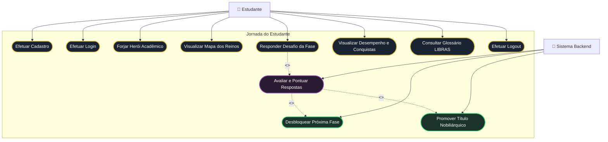
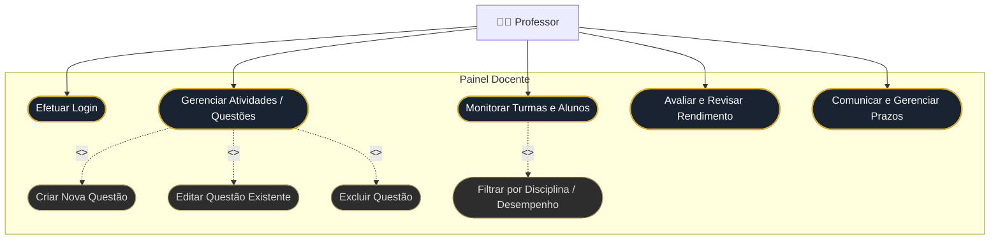
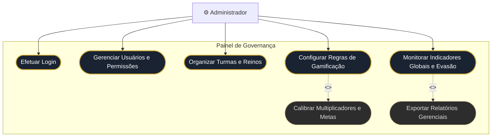

# 📐 Diagrama de Casos de Uso — Sistema Tronus

**Projeto Integrado Multidisciplinar (PIM III) — UNIP 2026**  
**Curso:** Superior de Tecnologia em Análise e Desenvolvimento de Sistemas (ADS)  
**Disciplina de Referência:** Engenharia de Software Ágil Aplicada  
**Modelagem Original:** Arquivo Astah UML (`docs/Engenharia de software ágil aplicada.asta`)  

---

## 📌 Sumário

1. [Visão Geral e Metodologia](#1-visão-geral-e-metodologia)
2. [Identificação dos Atores](#2-identificação-dos-atores)
3. [Diagrama Geral de Casos de Uso (UML)](#3-diagrama-geral-de-casos-de-uso-uml)
4. [Diagramas de Casos de Uso por Pacote](#4-diagramas-de-casos-de-uso-por-pacote)
   - [4.1 Módulo do Estudante (Aluno)](#41-módulo-do-estudante-aluno)
   - [4.2 Módulo do Professor](#42-módulo-do-professor)
   - [4.3 Módulo do Administrador](#43-módulo-do-administrador)
5. [Matriz de Rastreabilidade (Requisitos Funcionais vs. Casos de Uso)](#5-matriz-de-rastreabilidade-requisitos-funcionais-vs-casos-de-uso)
6. [Especificação Detalhada dos Principais Casos de Uso](#6-especificação-detalhada-dos-principais-casos-de-uso)

---

## 1. Visão Geral e Metodologia

O **Diagrama de Casos de Uso** é o artefato UML que mapeia o comportamento funcional externo do sistema Tronus. Ele descreve **quem** interage com o sistema (os *Atores*), **o que** cada usuário pode realizar (os *Casos de Uso*), e **como** esses processos se relacionam por meio de dependências de inclusão (`<<include>>`), extensão condicional (`<<extend>>`) e generalização/herança.

O modelo abrange a plataforma completa, contemplando tanto a interface do **Cliente Desktop (.NET 10)** para os estudantes quanto as interfaces web administrativas e docentes.

---

## 2. Identificação dos Atores

| Ator | Tipo | Papel e Responsabilidades no Sistema |
| :--- | :---: | :--- |
| **Estudante (Calouro)** | Primário / Humano | Usuário final da gamificação. Realiza cadastro, forja o herói acadêmico, explora os Reinos, responde aos desafios/quizzes, acumula estrelas e acompanha seu avanço de patentes (Plebeu a Rei). |
| **Professor** | Secundário / Humano | Gestor pedagógico. Cadastra e edita questões por matéria e fase, acompanha o desempenho das turmas e alunos, ajusta prazos e fornece feedbacks avaliativos. |
| **Administrador** | Secundário / Humano | Gestor de governança e infraestrutura. Gerencia o ciclo de vida dos usuários (alunos e professores), cadastra os Reinos e turmas, e define as regras e multiplicadores de gamificação. |
| **Sistema (Backend)** | Ator de Suporte | Motor automatizado que realiza autenticação JWT, validação de gabarito das respostas, cálculo instantâneo de estrelas, aplicação de penalidades, persistência da melhor marca (`GREATEST`) e promoção de títulos nobiliárquicos. |

---

## 3. Diagrama Geral de Casos de Uso (UML)

```mermaid
graph TB
    subgraph Sistema Tronus [Plataforma Gamificada Tronus]
        UC01([UC01: Efetuar Cadastro])
        UC02([UC02: Efetuar Login])
        UC03([UC03: Recuperar Senha])
        UC04([UC04: Forjar Personagem / Herói])
        UC05([UC05: Explorar Mapa dos Reinos])
        UC06([UC06: Responder Desafio / Quiz])
        UC07([UC07: Avaliar e Pontuar Respostas])
        UC08([UC08: Desbloquear Nova Fase])
        UC09([UC09: Promover Título Nobiliárquico])
        UC10([UC10: Visualizar Desempenho / Dashboard])
        UC11([UC11: Gerenciar Perfil e Acessibilidade])
        UC12([UC12: Efetuar Logout])
        
        UC13([UC13: Gerenciar Atividades e Questões])
        UC14([UC14: Monitorar Turmas e Alunos])
        UC15([UC15: Avaliar e Pontuar Estudantes])
        UC16([UC16: Comunicar e Gerenciar Prazos])
        
        UC17([UC17: Gerenciar Usuários])
        UC18([UC18: Organizar Turmas e Reinos])
        UC19([UC19: Configurar Gamificação])
        UC20([UC20: Monitorar Desempenho Global])
    end

    %% Atores
    Aluno["👤 Estudante (Aluno)"]
    Prof["👨‍🏫 Professor"]
    Admin["⚙️ Administrador"]
    Sys["🤖 Sistema Backend"]

    %% Relações do Aluno
    Aluno --> UC01
    Aluno --> UC02
    Aluno --> UC03
    Aluno --> UC04
    Aluno --> UC05
    Aluno --> UC06
    Aluno --> UC10
    Aluno --> UC11
    Aluno --> UC12

    %% Relações do Professor
    Prof --> UC02
    Prof --> UC13
    Prof --> UC14
    Prof --> UC15
    Prof --> UC16
    Prof --> UC12

    %% Relações do Administrador
    Admin --> UC02
    Admin --> UC17
    Admin --> UC18
    Admin --> UC19
    Admin --> UC20
    Admin --> UC12

    %% Dependências <<include>>
    UC06 -.->|<<include>>| UC02
    UC06 -.->|<<include>>| UC07
    UC13 -.->|<<include>>| UC02
    UC17 -.->|<<include>>| UC02

    %% Dependências <<extend>>
    UC07 -.->|<<extend>>| UC08
    UC07 -.->|<<extend>>| UC09
    UC02 -.->|<<extend>>| UC03

    %% Ação do Sistema
    Sys --> UC07
    Sys --> UC08
    Sys --> UC09
```

---

## 4. Diagramas de Casos de Uso por Pacote

### 4.1 Módulo do Estudante (Aluno)

Focado na jornada interativa do estudante e nas rotinas da aplicação Desktop:

---

### 4.2 Módulo do Professor

Gestão pedagógica do banco de questões e acompanhamento acadêmico:

---

### 4.3 Módulo do Administrador

Governança, segurança e calibração das regras da gamificação:

---

## 5. Matriz de Rastreabilidade (Requisitos Funcionais vs. Casos de Uso)

| Requisito Funcional | Descrição do Requisito | Caso de Uso Associado | Ator Responsável |
| :---: | :--- | :--- | :---: |
| **RF01** | Cadastro de usuário (Nome, E-mail, Celular, Senha) | UC01: Efetuar Cadastro | Estudante |
| **RF02** | Login via e-mail ou nome de usuário | UC02: Efetuar Login | Todos |
| **RF03** | Criação de personagem (Nome, Gênero, Avatar) | UC04: Forjar Herói Acadêmico | Estudante |
| **RF04** | Exibição de Reinos e progresso do usuário | UC05: Explorar Mapa dos Reinos | Estudante |
| **RF05** | Apresentação de quizzes com 5 questões por fase | UC06: Responder Desafio / Quiz | Estudante |
| **RF06** | Cálculo automático de estrelas (0 a 3 por fase) | UC07: Avaliar e Pontuar Respostas | Sistema Backend |
| **RF07** | Atualização do título do personagem (Plebeu a Rei) | UC09: Promover Título Nobiliárquico | Sistema Backend |
| **RF08** | Painel de análise com taxa de acertos e métricas | UC10: Visualizar Desempenho | Estudante |
| **RF09** | Glossário de termos técnicos em LIBRAS | UC11: Acessibilidade LIBRAS | Estudante |
| **RF10** | Redefinição de senha com validação | UC03: Recuperar Senha | Estudante |
| **RF11** | Painel exclusivo do professor para CRUD de questões | UC13: Gerenciar Atividades | Professor |
| **RF12** | Busca de alunos por nome e visualização de notas | UC14: Monitorar Turmas | Professor |
| **RF13** | Painel administrativo com estatísticas e CRUD de usuários | UC17: Gerenciar Usuários | Administrador |
| **RF14** | Confirmação (double-check) antes do logout | UC12: Efetuar Logout | Todos |
| **RF15** | Redirecionamento automático por papel de acesso | UC02: Efetuar Login | Sistema Backend |

---

## 6. Especificação Detalhada dos Principais Casos de Uso

### UC06: Responder Desafio / Quiz da Fase
* **Ator Principal:** Estudante (Aluno)
* **Ator Secundário:** Sistema Backend
* **Pré-condições:** O aluno deve estar autenticado e a fase selecionada deve estar desbloqueada (Fase 1 livre ou fase anterior com pontuação > 0).
* **Fluxo Principal:**
  1. O aluno seleciona uma fase disponível no Mapa dos Reinos e clica em "Jogar".
  2. O sistema requisita à API as 5 questões da fase (sem expor o gabarito).
  3. O aluno lê o enunciado da questão, analisa as alternativas [A] a [E] e marca a opção desejada.
  4. O aluno navega entre as questões pelos botões "Anterior" e "Próxima".
  5. Na 5ª questão, o aluno clica em "FINALIZAR ⚔".
  6. O sistema valida que todas as respostas foram preenchidas e envia o pacote à API.
  7. O caso de uso **UC07: Avaliar e Pontuar Respostas** é executado.
  8. O sistema exibe o cartão de resultados com estrelas, taxa de acerto e título atualizado.
* **Fluxos Alternativos:**
  * *FA01 - Abandono do Desafio:* O aluno clica em "Abandonar Desafio". O sistema solicita confirmação. Se confirmado, retorna ao Mapa sem salvar respostas incompletas.
  * *FA02 - Questões Pendentes de Marcação:* Se o aluno tentar finalizar sem responder todas as 5 questões, o sistema exibe aviso solicitando a conclusão das pendências.

---

### UC07: Avaliar e Pontuar Respostas (Automático)
* **Ator:** Sistema Backend
* **Tipo:** Execução Automatizada (`<<include>>` de UC06)
* **Fluxo Principal:**
  1. O sistema recebe as respostas enviadas pelo aluno.
  2. Compara cada alternativa marcada com o gabarito no banco de dados.
  3. Calcula a pontuação da rodada:
     - 4 ou 5 acertos (80% a 100%) $\rightarrow$ 3 Estrelas (`★★★`)
     - 3 acertos (60%) $\rightarrow$ 2 Estrelas (`★★☆`)
     - 2 acertos (40%) $\rightarrow$ 1 Estrela (`★☆☆`)
     - Menos de 2 acertos $\rightarrow$ 0 Estrelas (`☆☆☆`)
  4. Executa a procedure no PostgreSQL preservando a maior nota histórica da fase (`GREATEST`).
  5. Se a pontuação for $\ge 1$ estrela, dispara a extensão **UC08: Desbloquear Nova Fase**.
  6. Recalcula o somatório geral de estrelas do herói. Se o total atingir os patamares (15, 30 ou 45 estrelas), dispara a extensão **UC09: Promover Título Nobiliárquico**.
  7. Retorna o DTO consolidado com as métricas para renderização imediata na interface do aluno.

---

### UC13: Gerenciar Atividades e Questões (Docente)
* **Ator Principal:** Professor
* **Pré-condições:** Usuário autenticado com perfil `professor`.
* **Fluxo Principal:**
  1. O professor acessa o Painel Docente e seleciona o Reino desejado.
  2. Escolhe a Fase (1, 2 ou 3).
  3. O professor opta por:
     - **Cadastrar Questão:** Informa enunciado, nível de dificuldade (Fácil, Médio, Difícil), as 5 alternativas e seleciona a alternativa correta.
     - **Editar Questão:** Modifica texto, alternativas ou gabarito de questão existente.
     - **Excluir Questão:** Remove a questão após confirmação.
  4. O sistema valida os dados e persiste as alterações no PostgreSQL centralizado.
  5. A lista de questões da fase é atualizada imediatamente para todos os estudantes.

---

### UC18: Organizar Turmas e Reinos (Administrador)
* **Ator Principal:** Administrador
* **Pré-condições:** Usuário autenticado com perfil `admin`.
* **Fluxo Principal:**
  1. O administrador acessa a área de Gestão de Reinos e Turmas.
  2. Cadastra ou edita uma matéria/reino (definindo nome, sigla, ícone e ordem curricular).
  3. Cria as turmas acadêmicas (ex: *ADS 1º Semestre - Noturno*).
  4. Vincula os professores responsáveis às respectivas turmas e matérias.
  5. O sistema atualiza os privilégios de acesso e sincroniza as permissões no banco de dados.
