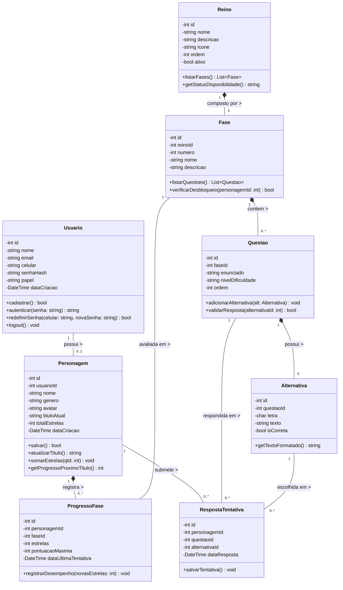
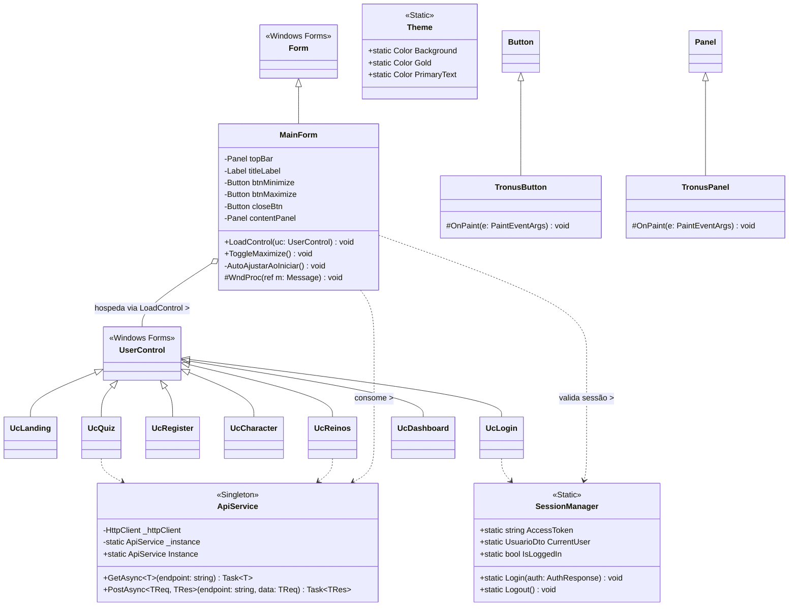

# 🏛️ Diagrama de Classes — Sistema Tronus

**Projeto Integrado Multidisciplinar (PIM III) — UNIP 2026**  
**Curso:** Superior de Tecnologia em Análise e Desenvolvimento de Sistemas (ADS)  
**Disciplina de Referência:** Programação Orientada a Objetos / Engenharia de Software  
**Ferramenta CASE Oficial:** Astah Community / Astah UML  
**Arquivo do Projeto:** `docs/Engenharia de software ágil aplicada.asta`  

---

## 📌 Sumário

1. [Visão Geral](#1-visão-geral)
2. [Status Atual do Arquivo Astah (`.asta`)](#2-status-atual-do-arquivo-astah-asta)
3. [Como Criar o Diagrama de Classes no Astah UML (Passo a Passo)](#3-como-criar-o-diagrama-de-classes-no-astah-uml-passo-a-passo)
4. [Diagrama de Classes Conceitual Completo (UML)](#4-diagrama-de-classes-conceitual-completo-uml)
5. [Dicionário de Classes do Domínio](#5-dicionário-de-classes-do-domínio)
6. [Relacionamentos e Multiplicidades](#6-relacionamentos-e-multiplicidades)
7. [Diagrama de Classes da Aplicação Desktop (C# / .NET 10)](#7-diagrama-de-classes-da-aplicação-desktop-c--net-10)

---

## 1. Visão Geral

O **Diagrama de Classes** é o mais importante diagrama estrutural da UML. Ele modela a visão estática do sistema Tronus, especificando as entidades de negócio, seus atributos privados com tipagem, seus métodos públicos de manipulação e as relações de associação, agregação, composição e herança entre elas.

No contexto acadêmico do PIM III (UNIP), este diagrama fundamenta a **Seção 5.3 (Diagrama de Classes Conceitual)** do relatório escrito (`docs/PIM_III_Tronus.docx`).

---

## 2. Status Atual do Arquivo Astah (`.asta`)

Ao analisar a estrutura interna do arquivo do projeto `docs/Engenharia de software ágil aplicada.asta`:
* **Diagramas Existentes:** O arquivo possui atualmente **2 Diagramas de Caso de Uso** (`Casos de uso - Estudante` e `Casos de uso - Professor / Administrador`).
* **Diagrama de Classes:** Ainda **não foi criado** dentro do arquivo `.asta` (o contador de classes `UClassImp` é zero).

> **Conclusão:** É perfeitamente possível e altamente recomendado criar o **Diagrama de Classes** dentro do próprio Astah UML, integrando todo o modelo de engenharia de software do PIM em um único arquivo de projeto!

---

## 3. Como Criar o Diagrama de Classes no Astah UML (Passo a Passo)

Para criar o diagrama no Astah Community / UML:

1. **Abrir o Projeto no Astah:**
   - Descompacte o arquivo `docs/Engenharia de software ágil aplicada.zip` se necessário.
   - Abra o Astah e selecione `File -> Open` -> `Engenharia de software ágil aplicada.asta`.

2. **Criar o Diagrama de Classes:**
   - Na árvore do projeto à esquerda (*Structure Tree*), clique com o botão direito no pacote raiz ou no pacote do projeto.
   - Selecione: **`Create Diagram` $\rightarrow$ `Class Diagram`**.
   - Nomeie o diagrama como: **`Diagrama de Classes - Tronus`**.

3. **Inserir as Classes:**
   - Na barra de ferramentas superior do Astah, clique no ícone **Class** (retângulo dividido em 3 compartimentos).
   - Clique na área de desenho para adicionar cada classe:
     - `Usuario`
     - `Personagem`
     - `Reino`
     - `Fase`
     - `Questao`
     - `Alternativa`
     - `ProgressoFase`
     - `RespostaTentativa`

4. **Adicionar Atributos e Métodos:**
   - Dê um duplo clique no segundo compartimento da classe para inserir atributos (ex: `- id: int`, `- nome: String`).
   - Dê um duplo clique no terceiro compartimento para inserir métodos (ex: `+ cadastrar(): boolean`, `+ salvar(): boolean`).
   - Use os símbolos de visibilidade UML:
     - `-` (Private / Privado) para atributos encapsulados.
     - `+` (Public / Público) para métodos da interface da classe.

5. **Traçar os Relacionamentos:**
   - Use a ferramenta **Association** (linha contínua) ou **Composition** (losango preto preenchido) para ligar as classes.
   - Defina as multiplicidades nas extremidades (`1`, `0..1`, `1..*`, `*`).

6. **Exportar a Imagem para o Relatório do PIM:**
   - Com o diagrama aberto, vá no menu: **`Tool` $\rightarrow$ `Export Image` $\rightarrow$ `Save Diagram as PNG/JPEG`**.
   - Salve a imagem com alta resolução para inserir na **Seção 5.3** do relatório do PIM III no Microsoft Word!

---

## 4. Diagrama de Classes Conceitual Completo (UML)

Abaixo está o modelo completo em sintaxe Mermaid, pronto para ser desenhado no Astah e incluído na documentação:

---

## 5. Dicionário de Classes do Domínio

### 5.1 `Usuario`
Representa a conta de acesso ao sistema (estudante, professor ou administrador).
* **Atributos:**
  * `id: int`: Identificador único no banco de dados.
  * `nome: string`: Nome completo do usuário.
  * `email: string`: E-mail institucional único.
  * `celular: string`: Telefone para contato e recuperação de senha.
  * `senhaHash: string`: Hash seguro da senha.
  * `papel: string`: Nível de acesso (`'aluno'`, `'professor'`, `'admin'`).
  * `dataCriacao: DateTime`: Registro de quando a conta foi criada.
* **Métodos:**
  * `cadastrar(): bool`: Valida e persiste o novo usuário.
  * `autenticar(senha: string): string`: Valida credenciais e gera o token JWT.
  * `redefinirSenha(celular: string, novaSenha: string): bool`: Atualiza a senha após confirmação.
  * `logout(): void`: Invalida o token e encerra a sessão ativa.

---

### 5.2 `Personagem`
Representa o alter-ego medieval do estudante na jornada acadêmica.
* **Atributos:**
  * `id: int`: Identificador do herói.
  * `usuarioId: int`: Chave estrangeira referenciando o `Usuario`.
  * `nome: string`: Nome de batalha do herói (ex: *Sir Artur*).
  * `genero: string`: Gênero escolhido (`'male'`, `'female'`).
  * `avatar: string`: Caminho do arquivo da ilustração do avatar (`img/masc1.png`, etc.).
  * `tituloAtual: string`: Patente nobiliárquica atual (`'Plebeu'`, `'Cavaleiro'`, `'Duque'`, `'Rei'`).
  * `totalEstrelas: int`: Total consolidado de estrelas conquistadas.
* **Métodos:**
  * `salvar(): bool`: Persiste o herói no banco de dados.
  * `atualizarTitulo(): string`: Recalcula o título com base nas metas (15, 30, 45 estrelas).
  * `somarEstrelas(qtd: int): void`: Incrementa a pontuação geral do estudante.
  * `getProgressoProximoTitulo(): int`: Retorna quantas estrelas faltam para a próxima patente.

---

### 5.3 `Reino`
Representa cada uma das disciplinas do curso (Python, C++, Engenharia de Software, etc.).
* **Atributos:**
  * `id: int`: Identificador do reino.
  * `nome: string`: Nome da matéria.
  * `descricao: string`: Resumo e objetivos pedagógicos.
  * `icone: string`: Arquivo do brasão/arte temático.
  * `ordem: int`: Posição de exibição na grade curricular.
  * `ativo: bool`: Indica se a matéria está habilitada.
* **Métodos:**
  * `listarFases(): List<Fase>`: Retorna as 3 fases do reino.
  * `getStatusDisponibilidade(): string`: Retorna `"DISPONÍVEL"` ou `"EM BREVE"`.

---

### 5.4 `Fase`
Representa cada uma das três etapas de aprendizado de um Reino.
* **Atributos:**
  * `id: int`: Identificador da fase.
  * `reinoId: int`: Chave estrangeira do Reino correspondente.
  * `numero: int`: Número da fase (1: Fundamentos, 2: Aprofundamento, 3: Desafio Mestre).
  * `nome: string`: Nome temático da fase.
* **Métodos:**
  * `listarQuestoes(): List<Questao>`: Obtém as 5 questões para o quiz.
  * `verificarDesbloqueio(personagemId: int): bool`: Valida se o herói possui ao menos 1 estrela na fase anterior.

---

### 5.5 `Questao` e `Alternativa`
Estrutura de avaliação pedagógica no padrão ENADE.
* **`Questao`:**
  * `enunciado: string`: Texto-base com contexto teórico e situações-problema.
  * `nivelDificuldade: string`: Grau de complexidade (`'facil'`, `'medio'`, `'dificil'`).
  * `validarResposta(alternativaId: int): bool`: Compara a opção com o gabarito.
* **`Alternativa`:**
  * `letra: char`: Letra da opção (`A`, `B`, `C`, `D` ou `E`).
  * `texto: string`: Texto explicativo da assertiva.
  * `isCorreta: bool`: Flag booleana que indica o gabarito oficial.

---

### 5.6 `ProgressoFase`
Armazena a conquista do herói em cada fase específica.
* **Atributos:**
  * `estrelas: int`: Quantidade de estrelas obtidas na fase (0 a 3).
  * `pontuacaoMaxima: int`: Maior pontuação histórica já registrada (`GREATEST`).
  * `dataUltimaTentativa: DateTime`: Data/hora da última execução do quiz.
* **Métodos:**
  * `registrarDesempenho(novasEstrelas: int): void`: Atualiza o registro caso a nova nota supere a anterior.

---

## 6. Relacionamentos e Multiplicidades

| Origem | Destino | Tipo de Relação | Multiplicidade | Descrição Semântica |
| :--- | :--- | :---: | :---: | :--- |
| `Usuario` | `Personagem` | Associação | `1` para `0..1` | Cada usuário possui no máximo um herói acadêmico vinculado. |
| `Personagem` | `ProgressoFase` | Composição | `1` para `0..*` | O progresso pertence exclusivamente ao herói; se o herói for excluído, seu histórico é removido. |
| `Reino` | `Fase` | Composição | `1` para `3` | Cada reino é composto estritamente por 3 fases pedagógicas. |
| `Fase` | `Questao` | Composição | `1` para `0..*` | As questões pertencem a uma fase específica. |
| `Questao` | `Alternativa` | Composição | `1` para `5` | Cada questão ENADE é composta por 5 alternativas (A a E). |
| `Personagem` | `RespostaTentativa` | Associação | `1` para `0..*` | Registra as marcações feitas pelo aluno nas tentativas. |

---

## 7. Diagrama de Classes da Aplicação Desktop (C# / .NET 10)

Para demonstrar a arquitetura de software implementada no cliente Desktop, o diagrama de classes da camada de apresentação e serviços é modelado a seguir:

