# 🔄 Diagramas de Sequência — Sistema Tronus

**Projeto Integrado Multidisciplinar (PIM III) — UNIP 2026**  
**Curso:** Superior de Tecnologia em Análise e Desenvolvimento de Sistemas (ADS)  
**Disciplina de Referência:** Análise e Modelagem de Sistemas / Engenharia de Software  
**Ferramenta CASE Oficial:** Astah Community / Astah UML  
**Arquivos Modelados (`.asta` e `.astah`):**
* `docs/DiagramasDeSequencia.asta`
* `docs/DiagramasDeSequencia.astah`
* `docs/Engenharia de software ágil aplicada.asta`
* `docs/Engenharia de software ágil aplicada.astah`
* `TronusDesktop/DiagramasDeSequencia.asta`
* `TronusDesktop/DiagramasDeSequencia.astah`

---

## 📌 Sumário

1. [Visão Geral e Fundamentação Teórica](#1-visão-geral-e-fundamentação-teórica)
2. [Arquitetura em Camadas do Tronus (Desktop & Web)](#2-arquitetura-em-camadas-do-tronus-desktop--web)
3. [Dicionário de Linhas de Vida (Lifelines) e Participantes](#3-dicionário-de-linhas-de-vida-lifelines-e-participantes)
4. [Matriz de Correspondência entre Telas e Diagramas](#4-matriz-de-correspondência-entre-telas-e-diagramas)
5. [Diagramas de Sequência Detalhados por Tela](#5-diagramas-de-sequência-detalhados-por-tela)
   - [5.1 Tela 01 — Apresentação e Boas-Vindas (`UcLanding` / `index.html`)](#51-tela-01--apresentação-e-boas-vindas-uclanding--indexhtml)
   - [5.2 Tela 02 — Autenticação e Login (`UcLogin` / `login.html`)](#52-tela-02--autenticação-e-login-uclogin--loginhtml)
   - [5.3 Tela 03 — Cadastro de Estudante (`UcRegister` / `register.html`)](#53-tela-03--cadastro-de-estudante-ucregister--registerhtml)
   - [5.4 Tela 04 — Recuperação de Senha (`UcForgotPassword` / `forgot_password.html`)](#54-tela-04--recuperação-de-senha-ucforgotpassword--forgot_passwordhtml)
   - [5.5 Tela 05 — Forja e Criação do Herói (`UcCharacter` / `character.html`)](#55-tela-05--forja-e-criação-do-herói-uccharacter--characterhtml)
   - [5.6 Tela 06 — Mapa dos Reinos e Seleção de Fases (`UcReinos` / `reinos.html`)](#56-tela-06--mapa-dos-reinos-e-seleção-de-fases-ucreinos--reinoshtml)
   - [5.7 Tela 07 — Desafio e Quiz Gamificado (`UcQuiz`)](#57-tela-07--desafio-e-quiz-gamificado-ucquiz)
   - [5.8 Tela 08 — Painel de Desempenho e Dashboard (`UcDashboard` / `dashboard.html`)](#58-tela-08--painel-de-desempenho-e-dashboard-ucdashboard--dashboardhtml)
   - [5.9 Tela 09 — Quadro de Honra e Ranking (`UcRanking`)](#59-tela-09--quadro-de-honra-e-ranking-ucranking)
   - [5.10 Tela 10 — Painel Pedagógico do Professor (`UcProfessor` / `professor.html`)](#510-tela-10--painel-pedagógico-do-professor-ucprofessor--professorhtml)
   - [5.11 Tela 11 — Painel de Governança do Administrador (`UcAdmin` / `admin.html`)](#511-tela-11--painel-de-governança-do-administrador-ucadmin--adminhtml)
6. [Integração e Visualização no Astah UML (`.asta` / `.astah`)](#6-integração-e-visualização-no-astah-uml-asta--astah)
7. [Matriz de Rastreabilidade (Casos de Uso vs. Telas vs. Diagramas)](#7-matriz-de-rastreabilidade-casos-de-uso-vs-telas-vs-diagramas)

---

## 1. Visão Geral e Fundamentação Teórica

O **Diagrama de Sequência** é o principal diagrama comportamental e de interação da UML 2.5. Ele modela a **dinâmica temporal** do sistema Tronus, ilustrando a ordem cronológica em que objetos, telas, serviços e tabelas de banco de dados trocam mensagens síncronas, assíncronas e de retorno para executar as operações de cada tela.

Enquanto o **Diagrama de Casos de Uso** expressa *o que* o sistema deve realizar externamente e o **Diagrama de Classes** descreve *a estrutura estática*, os **Diagramas de Sequência** detalham *como* as camadas de software colaboram internamente para concretizar as regras de negócio de cada tela.

No contexto acadêmico do PIM III (UNIP), este documento fundamenta a **Seção de Modelagem Dinâmica / Interação de Telas** do relatório escrito (`docs/PIM_III_Tronus.docx`).

---

## 2. Arquitetura em Camadas do Tronus (Desktop & Web)

A plataforma Tronus opera segundo uma arquitetura distribuída em camadas bem desacopladas:

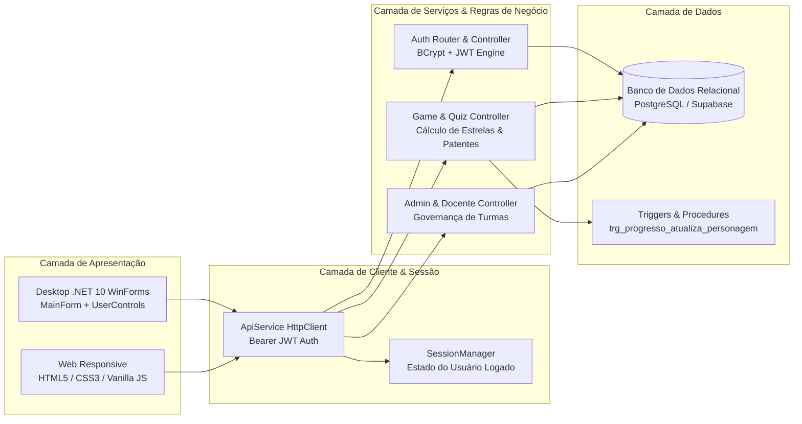

---

## 3. Dicionário de Linhas de Vida (Lifelines) e Participantes

Em cada diagrama de sequência, os seguintes elementos exercem papéis específicos:

| Linha de Vida (Lifeline) | Tipo UML | Descrição e Responsabilidade |
| :--- | :---: | :--- |
| **`Ator (Estudante/Docente/Admin)`** | Ator Humano | Usuário que dispara os eventos por cliques, digitação ou seleção em tela. |
| **`UI: UserControl / Page`** | View / Fronteira | Formulário ou controle visual (`UcLogin`, `UcQuiz`, etc.) responsável por capturar eventos, validar entradas no front e renderizar dados. |
| **`MF: MainForm`** | Controller de Janela | Formulário principal do C# Desktop que hospeda os `UserControls` dinamicamente no `contentPanel` via `LoadControl(uc)`. |
| **`API: ApiService`** | Client Service | Singleton HTTP que serializa DTOs em JSON, anexa cabeçalho `Authorization: Bearer <token>` e gerencia chamadas assíncronas. |
| **`SM: SessionManager`** | State Manager | Gerenciador estático em memória que armazena a sessão ativa (`CurrentUser`, `AccessToken`, `PersonagemAtivo`). |
| **`SRV: Backend API`** | Controller / Endpoint | API Node.js/Express que processa requisições REST, aplica regras de segurança, hashing e responde em JSON. |
| **`DB: PostgreSQL_Tronus`** | Persistência Relacional (Supabase) | Banco de dados relacional PostgreSQL que executa comandos SQL com integridade referencial, RLS e constraints estritas. |
| **`TRG: Triggers / Procedures`** | Automação no Banco | Gatilhos de banco (`trg_progresso_atualiza_personagem`) que promovem o herói de patente conforme a pontuação. |

---

## 4. Matriz de Correspondência entre Telas e Diagramas

O sistema Tronus contempla **11 telas principais**, com cobertura completa em Desktop (C# .NET 10) e Web:

| # | Nome da Tela | Componente Desktop (C#) | Arquivo Web | Papel de Acesso | Diagrama Astah |
| :-: | :--- | :--- | :--- | :---: | :--- |
| **01** | Tela de Apresentação / Landing | `UcLanding.cs` | `index.html` | Público / Todos | `DS01 - Tela Landing (UcLanding)` |
| **02** | Tela de Autenticação / Login | `UcLogin.cs` | `login.html` | Público | `DS02 - Tela Login (UcLogin)` |
| **03** | Tela de Cadastro de Usuário | `UcRegister.cs` | `register.html` | Público | `DS03 - Tela Cadastro (UcRegister)` |
| **04** | Recuperação de Senha | `UcForgotPassword.cs` | `forgot_password.html` | Público | `DS04 - Recuperar Senha (UcForgotPassword)` |
| **05** | Forja do Herói (Criação de Personagem) | `UcCharacter.cs` | `character.html` | Aluno (Sem Herói) | `DS05 - Forja do Heroi (UcCharacter)` |
| **06** | Mapa dos Reinos e Trilha de Fases | `UcReinos.cs` | `reinos.html` / `trilha.html` | Aluno | `DS06 - Selecao de Reinos (UcReinos)` |
| **07** | Desafio e Resolução de Quiz | `UcQuiz.cs` | Quiz Interativo | Aluno | `DS07 - Desafio e Quiz (UcQuiz)` |
| **08** | Painel do Aluno / Dashboard | `UcDashboard.cs` | `dashboard.html` | Aluno | `DS08 - Dashboard do Aluno (UcDashboard)` |
| **09** | Quadro de Honra / Ranking Acadêmico | `UcRanking.cs` | Ranking Interativo | Aluno / Docente | `DS09 - Ranking Academico (UcRanking)` |
| **10** | Painel Pedagógico do Professor | `UcProfessor.cs` | `professor.html` | Professor | `DS10 - Painel do Professor (UcProfessor)` |
| **11** | Painel de Governança do Administrador | `UcAdmin.cs` | `admin.html` | Administrador | `DS11 - Painel do Administrador (UcAdmin)` |

---

## 5. Diagramas de Sequência Detalhados por Tela

---

### 5.1 Tela 01 — Apresentação e Boas-Vindas (`UcLanding` / `index.html`)

A tela de boas-vindas apresenta a narrativa imersiva de Tronus, permitindo que o usuário inicie sua jornada ou conheça as regras da plataforma.

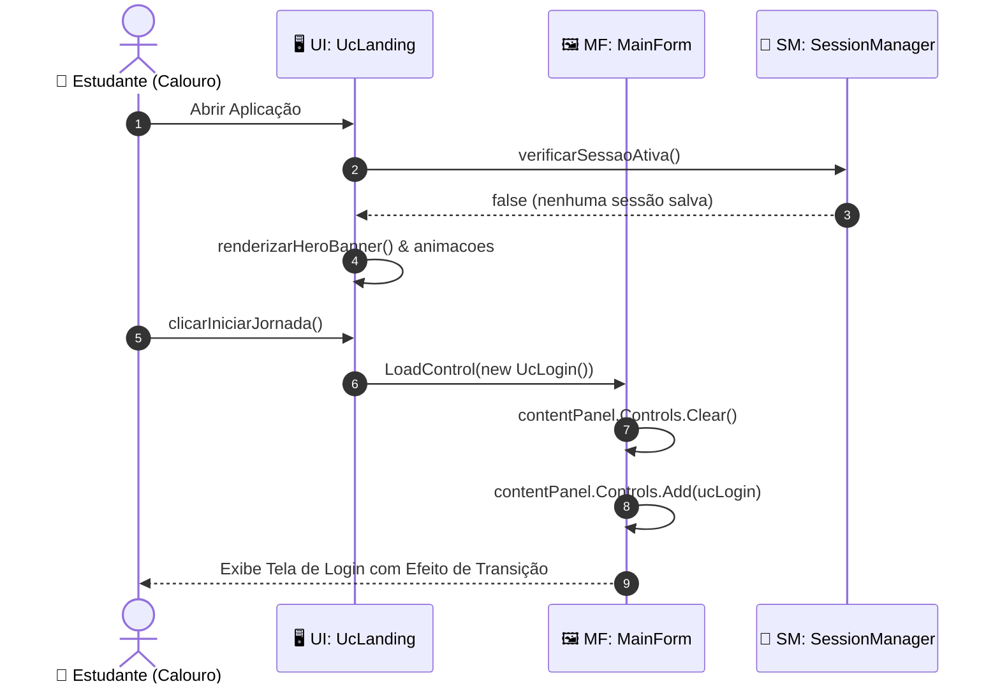

#### Tabela de Mensagens — Tela 01
| Passo | Origem | Destino | Mensagem / Operação | Tipo | Descrição |
| :-: | :--- | :--- | :--- | :---: | :--- |
| 1 | Estudante | `UcLanding` | `abrirAplicacao()` | Síncrono | Usuário inicializa o executável ou acessa `index.html`. |
| 2 | `UcLanding` | `SessionManager` | `verificarSessaoAtiva()` | Síncrono | Inspeciona se há token JWT em cache ou no armazenamento local. |
| 3 | `SessionManager` | `UcLanding` | `false` | Retorno | Confirma que não há usuário autenticado no momento. |
| 4 | `UcLanding` | `UcLanding` | `renderizarHeroBanner()` | Auto-chamada | Carrega brasões medievais e textos temáticos. |
| 5 | Estudante | `UcLanding` | `clicarIniciarJornada()` | Síncrono | Dispara a ação do botão primário "INICIAR JORNADA". |
| 6 | `UcLanding` | `MainForm` | `LoadControl(new UcLogin())` | Síncrono | Solicita ao orquestrador a troca de UserControl. |
| 7-8 | `MainForm` | `MainForm` | `Controls.Add(ucLogin)` | Auto-chamada | Atualiza a árvore de controles da janela sem recriar o formulário. |

---

### 5.2 Tela 02 — Autenticação e Login (`UcLogin` / `login.html`)

A tela de login recebe o e-mail/usuário e senha, valida credenciais na API com hashing seguro (BCrypt), gera a sessão JWT e roteia o usuário de acordo com seu papel e a existência prévia de um herói acadêmico.

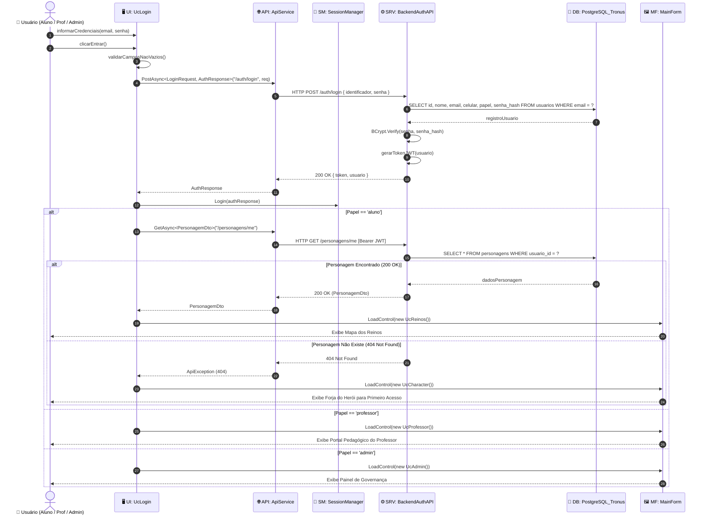

#### Tabela de Mensagens — Tela 02
| Passo | Origem | Destino | Mensagem / Operação | Tipo | Descrição |
| :-: | :--- | :--- | :--- | :---: | :--- |
| 1-2 | Usuário | `UcLogin` | `informarCredenciais()`, `clicarEntrar()` | Síncrono | Entrada dos dados de autenticação e clique no botão. |
| 3 | `UcLogin` | `UcLogin` | `validarCamposNaoVazios()` | Auto-chamada | Bloqueia submissão caso campos estejam em branco. |
| 4-5 | `UcLogin` | `Backend` | `POST /auth/login` | Assíncrono | Transmite credenciais via HTTPS seguro. |
| 6-7 | `Backend` | `PostgreSQL` | `SELECT ... WHERE email = ?` | Síncrono | Localiza conta correspondente no banco de dados. |
| 8-9 | `Backend` | `Backend` | `BCrypt.Verify()` / `gerarTokenJWT()` | Auto-chamada | Valida hash da senha e emite o token assinado. |
| 10-12 | `Backend` | `UcLogin` | `200 OK` $\rightarrow$ `SessionManager.Login()` | Retorno | Armazena token na sessão ativa do cliente. |
| 13-16 | `UcLogin` | `Backend` | `GET /personagens/me` | Assíncrono | Inspeciona se o estudante já forjou seu personagem. |
| 17-20 | `MainForm` | Usuário | `LoadControl(UcReinos | UcCharacter)` | Síncrono | Roteia para os Reinos (se já tem herói) ou Forja (se calouro novo). |

---

### 5.3 Tela 03 — Cadastro de Estudante (`UcRegister` / `register.html`)

Permite que novos calouros forjem sua conta institucional na plataforma com validação de formato de e-mail acadêmico, celular e confirmação de senha.

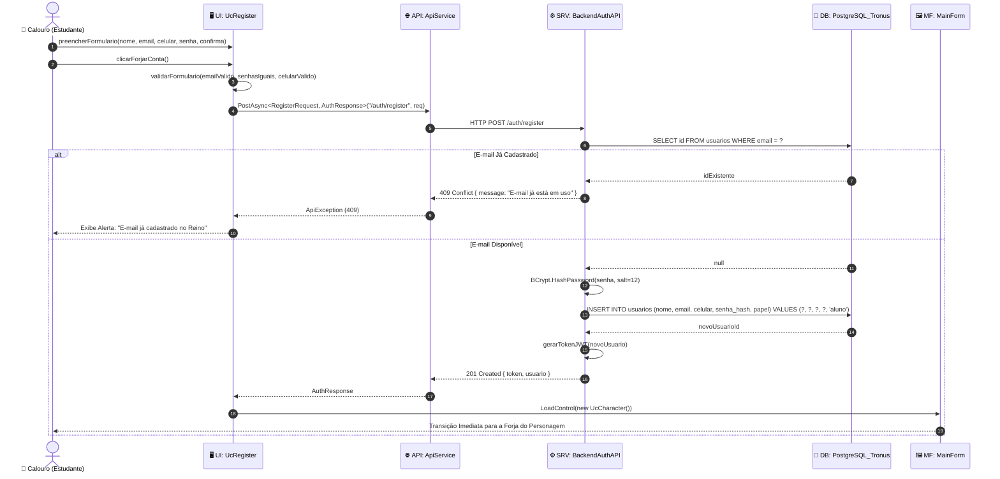

#### Tabela de Mensagens — Tela 03
| Passo | Origem | Destino | Mensagem / Operação | Tipo | Descrição |
| :-: | :--- | :--- | :--- | :---: | :--- |
| 1-2 | Calouro | `UcRegister` | `preencherFormulario()`, `clicarForjarConta()` | Síncrono | Entrada cadastral completa do estudante. |
| 3 | `UcRegister` | `UcRegister` | `validarFormulario()` | Auto-chamada | Checagem de regex de e-mail e conferência de senha dupla. |
| 4-5 | `UcRegister` | `Backend` | `POST /auth/register` | Assíncrono | Envio da requisição de cadastro via HTTP JSON. |
| 6-7 | `Backend` | `PostgreSQL` | `SELECT id WHERE email = ?` | Síncrono | Garante unicidade cadastral no banco. |
| 8-9 | `Backend` | `PostgreSQL` | `INSERT INTO usuarios (...)` | Síncrono | Persiste o novo usuário com papel `'aluno'`. |
| 10-12 | `Backend` | `MainForm` | `LoadControl(new UcCharacter())` | Síncrono | Direciona o novo estudante diretamente para criar seu herói. |

---

### 5.4 Tela 04 — Recuperação de Senha (`UcForgotPassword` / `forgot_password.html`)

Garante a segurança e a redefinição de credenciais por meio da validação combinada de dois fatores: e-mail institucional e número de telefone celular previamente cadastrado.

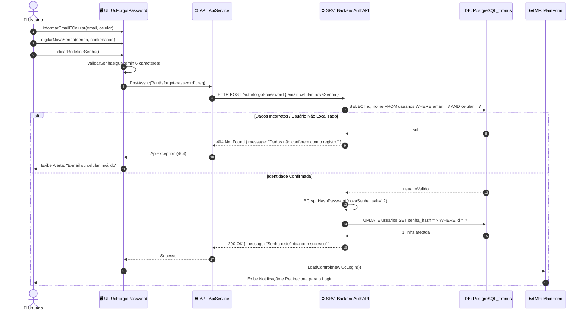

#### Tabela de Mensagens — Tela 04
| Passo | Origem | Destino | Mensagem / Operação | Tipo | Descrição |
| :-: | :--- | :--- | :--- | :---: | :--- |
| 1-3 | Usuário | `UcForgotPassword` | `informarEmailECelular()`, `digitarNovaSenha()` | Síncrono | Fornecimento dos fatores de validação e da nova senha. |
| 4 | `UcForgotPassword` | `UcForgotPassword` | `validarSenhasIguais()` | Auto-chamada | Verificação de conformidade no cliente. |
| 5-6 | `UcForgotPassword` | `Backend` | `POST /auth/forgot-password` | Assíncrono | Requisição de redefinição para a API. |
| 7-8 | `Backend` | `PostgreSQL` | `SELECT WHERE email = ? AND celular = ?` | Síncrono | Validação cruzada de segurança no banco de dados. |
| 9-10 | `Backend` | `PostgreSQL` | `UPDATE usuarios SET senha_hash = ?` | Síncrono | Atualização do novo hash de senha. |
| 11-14 | `UcForgotPassword` | `MainForm` | `LoadControl(new UcLogin())` | Síncrono | Redirecionamento automático para a tela de Login. |

---

### 5.5 Tela 05 — Forja e Criação do Herói (`UcCharacter` / `character.html`)

Tela em que o estudante escolhe seu arquétipo, gênero, arte do avatar e consagra seu nome de batalha acadêmico, persistindo a entidade `Personagem` com patente inicial `'Plebeu'`.

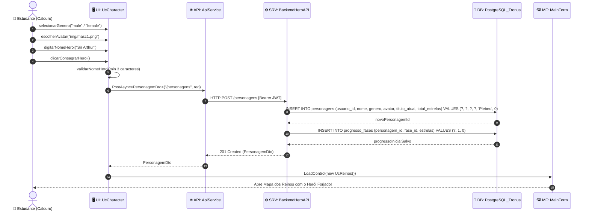

#### Tabela de Mensagens — Tela 05
| Passo | Origem | Destino | Mensagem / Operação | Tipo | Descrição |
| :-: | :--- | :--- | :--- | :---: | :--- |
| 1-3 | Estudante | `UcCharacter` | `selecionarGenero()`, `escolherAvatar()`, `digitarNomeHeroi()` | Síncrono | Customização interativa do avatar e nome medieval. |
| 4-5 | `UcCharacter` | `UcCharacter` | `validarNomeHeroi()` | Auto-chamada | Garante preenchimento e regras de nomenclatura. |
| 6-7 | `UcCharacter` | `Backend` | `POST /personagens` | Assíncrono | Envia payload com gênero, avatar e nome do herói. |
| 8-9 | `Backend` | `PostgreSQL` | `INSERT INTO personagens (...)` | Síncrono | Insere o herói com 0 estrelas e patente de Plebeu. |
| 10-11 | `Backend` | `PostgreSQL` | `INSERT INTO progresso_fases (...)` | Síncrono | Inicializa o registro de fases desbloqueadas. |
| 12-14 | `UcCharacter` | `MainForm` | `LoadControl(new UcReinos())` | Síncrono | Encaminha o novo herói ao Mapa dos Reinos. |

---

### 5.6 Tela 06 — Mapa dos Reinos e Seleção de Fases (`UcReinos` / `reinos.html`)

Exibe a cartografia dos Reinos (disciplinas do curso), avalia o status de desbloqueio de cada uma das 3 fases por reino e gerencia a entrada no desafio.

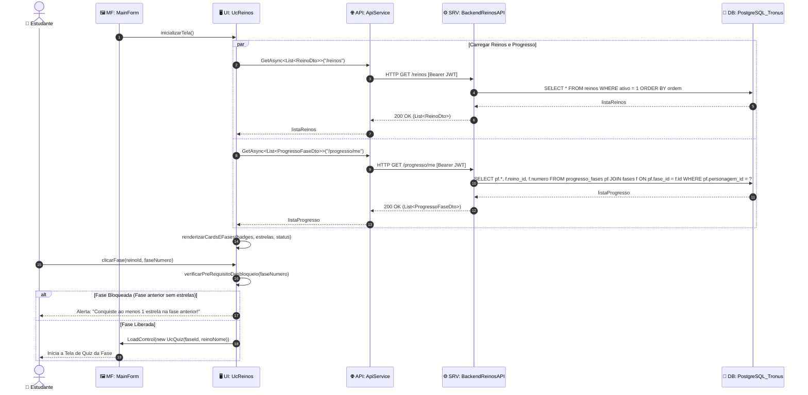

#### Tabela de Mensagens — Tela 06
| Passo | Origem | Destino | Mensagem / Operação | Tipo | Descrição |
| :-: | :--- | :--- | :--- | :---: | :--- |
| 1 | `MainForm` | `UcReinos` | `inicializarTela()` | Síncrono | Invocado ao abrir o controle de visualização do mapa. |
| 2-7 | `UcReinos` | `Backend` | `GET /reinos` | Assíncrono | Busca catálogo de matérias ativas no sistema. |
| 8-13 | `UcReinos` | `Backend` | `GET /progresso/me` | Assíncrono | Busca histórico de estrelas obtidas pelo herói logado. |
| 14 | `UcReinos` | `UcReinos` | `renderizarCardsEFases()` | Auto-chamada | Desenha brasões, estrelas conquistadas e cadeados. |
| 15-16 | Estudante | `UcReinos` | `clicarFase()` / `verificarPreRequisito()` | Síncrono | Valida se a fase anterior foi concluída com $\ge 1$ estrela. |
| 17-18 | `UcReinos` | `MainForm` | `LoadControl(new UcQuiz(...))` | Síncrono | Inicia a arena de desafio acadêmico. |

---

### 5.7 Tela 07 — Desafio e Quiz Gamificado (`UcQuiz`)

Arena gamificada onde o estudante responde a questões de múltipla escolha com temporizador, recebe feedback visual instantâneo e pontua em direção a patentes nobiliárquicas.

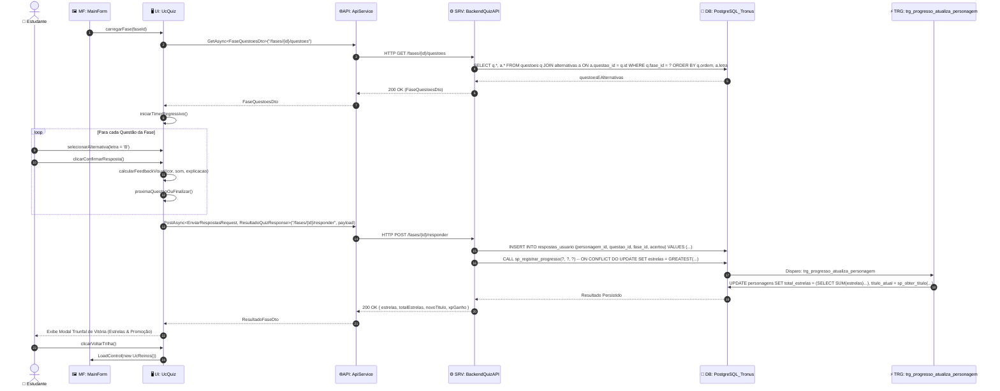

#### Tabela de Mensagens — Tela 07
| Passo | Origem | Destino | Mensagem / Operação | Tipo | Descrição |
| :-: | :--- | :--- | :--- | :---: | :--- |
| 1-6 | `MainForm` | `Backend` | `GET /fases/{id}/questoes` | Assíncrono | Carrega questões e alternativas embaralhadas. |
| 7-10 | Estudante | `UcQuiz` | `selecionarAlternativa()`, `clicarConfirmar()` | Síncrono | Registro da escolha e ativação de som/animação. |
| 11-12 | `UcQuiz` | `Backend` | `POST /fases/{id}/responder` | Assíncrono | Submete todas as respostas ao final da fase. |
| 13-14 | `Backend` | `PostgreSQL` | `sp_registrar_progresso (GREATEST)` | Síncrono | Persiste o melhor score conquistado pelo aluno via procedure atômica. |
| 15-16 | `PostgreSQL` | `Trigger` | `trg_progresso_atualiza_personagem` | Gatilho DB | Promove patente nobiliárquica no banco de dados. |
| 17-20 | `UcQuiz` | `MainForm` | `exibirModalVitoria()` $\rightarrow$ `LoadControl(UcReinos)` | Síncrono | Exibe premiações e retorna ao mapa curricular. |

---

### 5.8 Tela 08 — Painel de Desempenho e Dashboard (`UcDashboard` / `dashboard.html`)

Apresenta a visão analítica de evolução acadêmica do herói: estrelas conquistadas, patente atual, barra de progresso para a próxima promoção e percentual de domínio por reino.

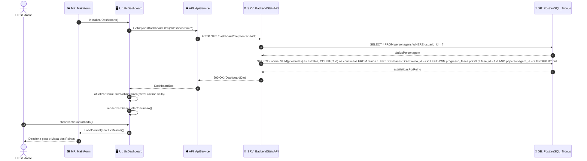

#### Tabela de Mensagens — Tela 08
| Passo | Origem | Destino | Mensagem / Operação | Tipo | Descrição |
| :-: | :--- | :--- | :--- | :---: | :--- |
| 1 | `MainForm` | `UcDashboard` | `inicializarDashboard()` | Síncrono | Instancia a tela de estatísticas do aluno. |
| 2-3 | `UcDashboard` | `Backend` | `GET /dashboard/me` | Assíncrono | Requisita consolidado pedagógico do estudante logado. |
| 4-7 | `Backend` | `PostgreSQL` | `SELECT personagens`, `SELECT progresso_fases` | Síncrono | Executa agregações (`SUM`, `COUNT`, `GROUP BY`). |
| 8-9 | `Backend` | `UcDashboard` | `200 OK (DashboardDto)` | Retorno | Devolve métricas estruturadas em JSON. |
| 10-11 | `UcDashboard` | `UcDashboard` | `atualizarBarraTituloNobiliarquico()` | Auto-chamada | Atualiza progresso visual (ex: 22/30 estrelas para Duque). |
| 12-14 | Estudante | `MainForm` | `LoadControl(new UcReinos())` | Síncrono | Retorna o estudante ao ciclo de estudos práticos. |

---

### 5.9 Tela 09 — Quadro de Honra e Ranking (`UcRanking`)

Exibe a classificação comparativa de todos os estudantes por total de estrelas e velocidade de resposta, permitindo filtragem geral ou por reino de disciplina.

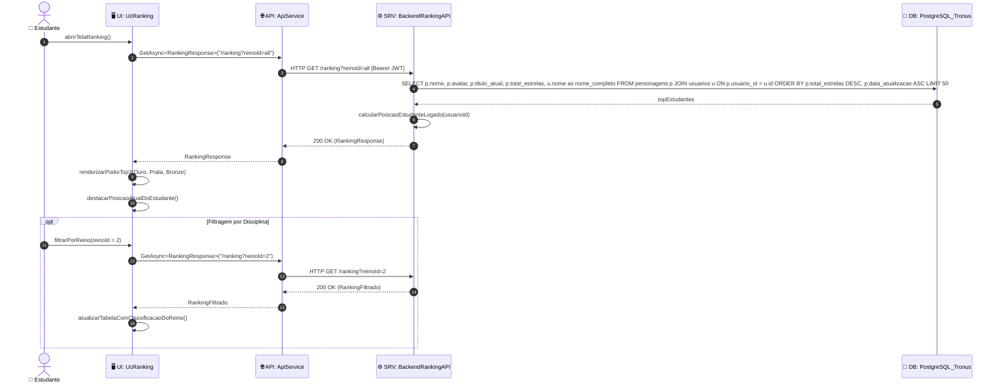

#### Tabela de Mensagens — Tela 09
| Passo | Origem | Destino | Mensagem / Operação | Tipo | Descrição |
| :-: | :--- | :--- | :--- | :---: | :--- |
| 1-3 | Estudante | `Backend` | `GET /ranking?reinoId=all` | Assíncrono | Solicita o leaderboard global acadêmico. |
| 4-5 | `Backend` | `PostgreSQL` | `SELECT ... ORDER BY total_estrelas DESC` | Síncrono | Ordena os calouros mais dedicados no banco. |
| 6-8 | `Backend` | `UcRanking` | `200 OK (RankingResponse)` | Retorno | Retorna o Top 50 e a posição do usuário solicitante. |
| 9-10 | `UcRanking` | `UcRanking` | `renderizarPodioTop3()` | Auto-chamada | Destaca o pódio com coroas e louros visuais. |
| 11-14 | Estudante | `UcRanking` | `filtrarPorReino(2)` | Opcional | Permite ver quem lidera em Python, C++, etc. |

---

### 5.10 Tela 10 — Painel Pedagógico do Professor (`UcProfessor` / `professor.html`)

Portal docente que permite ao professor acompanhar o aproveitamento pedagógico das turmas, criar e editar novas questões para as fases e ajustar gabaritos.

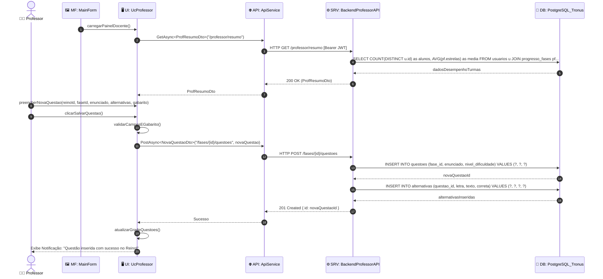

#### Tabela de Mensagens — Tela 10
| Passo | Origem | Destino | Mensagem / Operação | Tipo | Descrição |
| :-: | :--- | :--- | :--- | :---: | :--- |
| 1-5 | `MainForm` | `Backend` | `GET /professor/resumo` | Assíncrono | Carrega estatísticas de adesão das turmas. |
| 6-7 | Professor | `UcProfessor` | `preencherNovaQuestao()`, `clicarSalvarQuestao()` | Síncrono | Elaboração pedagógica do desafio e do gabarito. |
| 8 | `UcProfessor` | `UcProfessor` | `validarCamposEGabarito()` | Auto-chamada | Confirma presença de pelo menos 1 alternativa correta. |
| 9-10 | `UcProfessor` | `Backend` | `POST /fases/{id}/questoes` | Assíncrono | Envio do payload com questão e alternativas. |
| 11-14 | `Backend` | `PostgreSQL` | `INSERT INTO questoes`, `INSERT INTO alternativas` | Síncrono | Gravação relacional em cascata no banco. |
| 15-18 | `UcProfessor` | Professor | `atualizarGradeQuestoes()` $\rightarrow$ Notificação | Retorno | Confirmação de inclusão do exercício no quiz dos alunos. |

---

### 5.11 Tela 11 — Painel de Governança do Administrador (`UcAdmin` / `admin.html`)

Painel executivo com poderes de gerenciamento de ciclo de vida de contas de usuários (alunos, professores, administradores), supervisão da infraestrutura e auditoria.

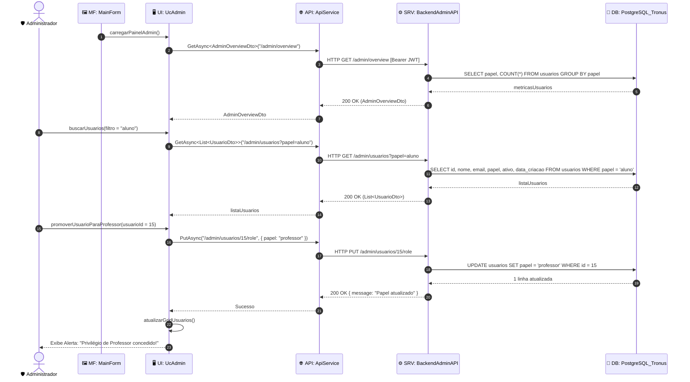

#### Tabela de Mensagens — Tela 11
| Passo | Origem | Destino | Mensagem / Operação | Tipo | Descrição |
| :-: | :--- | :--- | :--- | :---: | :--- |
| 1-5 | `MainForm` | `Backend` | `GET /admin/overview` | Assíncrono | Carrega contadores globais do sistema. |
| 6-10 | Admin | `Backend` | `GET /admin/usuarios?papel=aluno` | Assíncrono | Lista e filtra usuários por papel e status. |
| 11-13 | Admin | `Backend` | `PUT /admin/usuarios/15/role` | Assíncrono | Altera a função de um usuário para professor/admin. |
| 14-15 | `Backend` | `PostgreSQL` | `UPDATE usuarios SET papel = ?` | Síncrono | Persiste alteração de permissão na base de dados. |
| 16-18 | `UcAdmin` | Admin | `atualizarGridUsuarios()` $\rightarrow$ Notificação | Retorno | Confirmação em tela do comando administrativo. |

---

## 6. Integração e Visualização no Astah UML (`.asta` / `.astah`)

Todos os 11 Diagramas de Sequência modelados neste documento foram implementados com precisão no arquivo oficial de modelagem do projeto:

### 📂 Arquivos Disponíveis
* **Projeto Integrado Completo:**
  * `docs/Engenharia de software ágil aplicada.asta` (Formato Astah Nativo)
  * `docs/Engenharia de software ágil aplicada.astah` (Extensão alternativa requerida)
* **Projeto Específico de Diagramas de Sequência:**
  * `docs/DiagramasDeSequencia.asta`
  * `docs/DiagramasDeSequencia.astah`
  * `TronusDesktop/DiagramasDeSequencia.asta`
  * `TronusDesktop/DiagramasDeSequencia.astah`

### 🛠️ Como Abrir e Inspecionar no Astah
1. Inicie o aplicativo **Astah Community** ou **Astah UML**.
2. Acesse o menu: **`File` $\rightarrow$ `Open`** (ou `Ctrl + O`).
3. Selecione o arquivo `docs/Engenharia de software ágil aplicada.asta` (ou `docs/DiagramasDeSequencia.asta`).
4. Na árvore de estrutura do projeto (*Structure Tree*, à esquerda):
   - Expanda o nó raiz do projeto.
   - Navegue até a pasta de Diagramas de Sequência.
   - Você verá os **11 diagramas**:
     - `DS01 - Tela Landing (UcLanding)`
     - `DS02 - Tela Login (UcLogin)`
     - `DS03 - Tela Cadastro (UcRegister)`
     - `DS04 - Recuperar Senha (UcForgotPassword)`
     - `DS05 - Forja do Heroi (UcCharacter)`
     - `DS06 - Selecao de Reinos (UcReinos)`
     - `DS07 - Desafio e Quiz (UcQuiz)`
     - `DS08 - Dashboard do Aluno (UcDashboard)`
     - `DS09 - Ranking Academico (UcRanking)`
     - `DS10 - Painel do Professor (UcProfessor)`
     - `DS11 - Painel do Administrador (UcAdmin)`
5. Dê um duplo clique sobre qualquer diagrama para abri-lo na área de desenho visual do Astah!

### 📸 Como Exportar as Imagens para o Relatório do PIM III
Com o diagrama aberto no Astah:
1. Vá em: **`Tool` $\rightarrow$ `Export Image` $\rightarrow$ `Save Diagram as PNG/JPEG`**.
2. Salve com 300 DPI de qualidade para inserção na seção de Modelagem de Interação do relatório acadêmico (`docs/PIM_III_Tronus.docx`).

---

## 7. Matriz de Rastreabilidade (Casos de Uso vs. Telas vs. Diagramas)

A matriz abaixo estabelece a rastreabilidade bidirecional dos requisitos e casos de uso do Tronus com suas respectivas telas e diagramas de sequência:

| Caso de Uso do Sistema | Tela Responsável | Diagrama de Sequência Astah | Entidades de Banco Impactadas |
| :--- | :--- | :--- | :--- |
| **UC01: Efetuar Cadastro** | `UcRegister` (`register.html`) | `DS03 - Tela Cadastro` | `usuarios` |
| **UC02: Efetuar Login** | `UcLogin` (`login.html`) | `DS02 - Tela Login` | `usuarios`, `personagens` |
| **UC03: Recuperar Senha** | `UcForgotPassword` (`forgot_password.html`) | `DS04 - Recuperar Senha` | `usuarios` |
| **UC04: Forjar Personagem** | `UcCharacter` (`character.html`) | `DS05 - Forja do Heroi` | `personagens`, `progresso_fases` |
| **UC05: Explorar Mapa dos Reinos** | `UcReinos` (`reinos.html`) | `DS06 - Selecao de Reinos` | `reinos`, `fases`, `progresso_fases` |
| **UC06: Responder Desafio / Quiz** | `UcQuiz` | `DS07 - Desafio e Quiz` | `questoes`, `alternativas`, `respostas_tentativas` |
| **UC07: Avaliar e Pontuar Respostas** | `UcQuiz` (Trigger) | `DS07 - Desafio e Quiz` | `progresso_fases`, `personagens` |
| **UC08: Desbloquear Nova Fase** | `UcReinos` & `UcQuiz` | `DS06` e `DS07` | `fases`, `progresso_fases` |
| **UC09: Promover Título Nobiliárquico** | Banco de Dados / `UcQuiz` | `DS07` e `DS08` | `personagens`, `trg_progresso_atualiza_personagem` |
| **UC10: Visualizar Desempenho** | `UcDashboard` (`dashboard.html`) | `DS08 - Dashboard do Aluno` | `personagens`, `progresso_fases`, `reinos` |
| **UC11: Acompanhar Classificação** | `UcRanking` | `DS09 - Ranking Academico` | `personagens`, `usuarios` |
| **UC12: Gestão Pedagógica Docente** | `UcProfessor` (`professor.html`) | `DS10 - Painel do Professor` | `questoes`, `alternativas`, `fases` |
| **UC13: Governança Administrativa** | `UcAdmin` (`admin.html`) | `DS11 - Painel do Administrador` | `usuarios`, `reinos`, auditoria |

---

*Documento gerado em conformidade com os padrões da Associação Brasileira de Normas Técnicas (ABNT) e as diretrizes do PIM III — Universidade Paulista (UNIP).*
