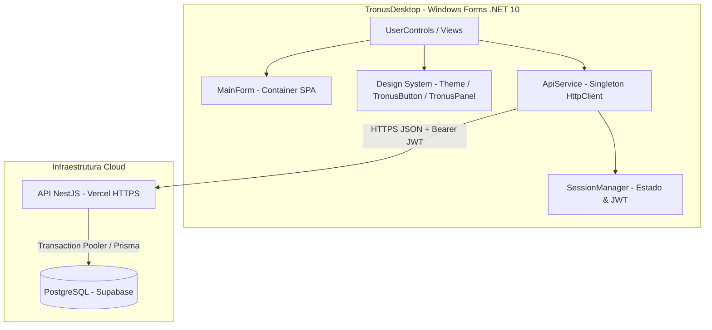
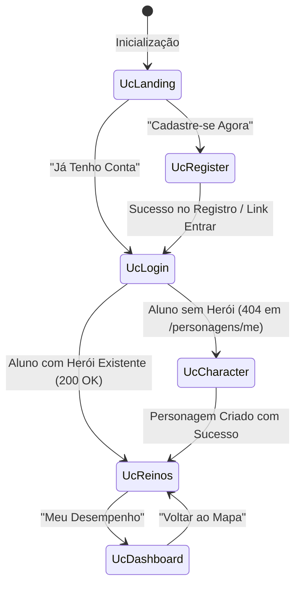

# ⚔️ TronusDesktop — Cliente Windows (.NET 10 / Windows Forms)

Aplicação desktop oficial da plataforma gamificada **Tronus**, desenvolvida em **C#** sobre o ecossistema **.NET 10 (Windows Forms)**. O cliente desktop foi concebido no modelo **Thin Client (Cliente Leve)**, integrando-se via HTTP/REST à API central na nuvem (`https://king-blue-nine.vercel.app`) conectada ao banco de dados relacional **PostgreSQL (Supabase)**.

---

## 📌 Sumário

1. [Visão Geral & Arquitetura](#-visão-geral--arquitetura)
2. [Estrutura do Projeto](#-estrutura-do-projeto)
3. [Design System & Identidade Visual](#-design-system--identidade-visual)
4. [Camada de Serviços & Comunicação HTTP](#-camada-de-serviços--comunicação-http)
5. [Telas & Fluxo de Navegação (Views)](#-telas--fluxo-de-navegação-views)
6. [Modelos de Dados (DTOs)](#-modelos-de-dados-dtos)
7. [Pré-requisitos & Como Executar](#-pré-requisitos--como-executar)
8. [Roteiro de Testes e Validação](#-roteiro-de-testes-e-validação)
9. [Credenciais de Homologação](#-credenciais-de-homologação)

---

## 🏛️ Visão Geral & Arquitetura

O **TronusDesktop** opera como um cliente desacoplado da persistência física de dados. Em vez de abrir conexões diretas via driver de banco de dados (o que exporia credenciais e contornaria regras de negócio e RLS), o sistema segue rigorosamente a arquitetura em camadas:



### Princípios Arquiteturais:
* **Single Page Application (SPA) Desktop:** O formulário principal (`MainForm`) atua como container fixo (1024×768), sem recriar formulários. A navegação entre telas é realizada dinamicamente alternando instâncias de `UserControl` no painel central via método `LoadControl(UserControl uc)`.
* **Zero Client Calculation:** Regras de negócio como progressão de títulos (Plebeu → Cavaleiro → Duque → Rei), cálculo de estrelas e taxa de acerto são calculadas centralmente pelo banco e API. O cliente desktop consome e exibe essas informações de forma reativa.
* **Segurança e Sessão Stateless:** Autenticação baseada em tokens JWT. Ao efetuar login, o token é injetado automaticamente nos headers de todas as chamadas protegidas (`Authorization: Bearer <token>`). Se a API retornar `401 Unauthorized`, a sessão é invalidada e o usuário é redirecionado para a tela de autenticação.

---

## 📂 Estrutura do Projeto

```
TronusDesktop/
├── Models/                     # DTOs de envio e resposta da API
│   ├── ApiErrorResponse.cs     # Mapeamento de erros padronizados da API
│   ├── AuthModels.cs           # Login, Registro, Recuperação e Dados do Usuário
│   ├── DashboardModels.cs      # Estatísticas, KPIs e histórico de respostas
│   ├── PersonagemModels.cs     # Criação e perfil do herói
│   └── ReinoModels.cs          # Matérias/Reinos e progresso por fases
├── Services/                   # Comunicação e infraestrutura
│   ├── ApiException.cs         # Exceção customizada com códigos e mensagens da API
│   ├── ApiService.cs           # Singleton HTTP com injeção de JWT e tratamento de erros
│   └── SessionManager.cs       # Armazenamento em memória da sessão e usuário logado
├── UI/                         # Componentes visuais personalizados
│   ├── Theme.cs                # Paleta de cores, gradientes e constantes visuais
│   ├── TronusButton.cs         # Botão customizado com cantos arredondados e hover
│   └── TronusPanel.cs          # Card medieval translúcido com borda dourada
├── Views/                      # Telas (UserControls) do sistema
│   ├── UcLanding.cs            # Tela de boas-vindas / Hero
│   ├── UcLogin.cs              # Autenticação de usuários
│   ├── UcRegister.cs           # Cadastro de novo estudante
│   ├── UcCharacter.cs          # Seleção de gênero e escolha de avatar
│   ├── UcReinos.cs             # Mapa dos 5 reinos e fases
│   └── UcDashboard.cs          # Painel de desempenho e análise de métricas
├── MainForm.cs                 # Formulário principal sem bordas (Container SPA)
├── Program.cs                  # Ponto de entrada do executável Windows
└── TronusDesktop.csproj        # Configuração do projeto (.NET 10, Windows Forms)
```

---

## 🎨 Design System & Identidade Visual

O **TronusDesktop** foi construído para fugir da estética cinza padrão do Windows Forms tradicional, entregando uma atmosfera medieval estilizada e imersiva:

* **Janela Sem Bordas (Borderless):** `FormBorderStyle = FormBorderStyle.None` com barra superior personalizada (`TopBar`) arrastável e botão de fechar estilizado.
* **Paleta de Cores (`Theme.cs`):**
  * `Background`: `#1A1A1A` (Grafite escuro de alta legibilidade).
  * `CardBackground`: `rgba(0, 0, 0, 0.5)` (Efeito de vidro escuro / Glassmorphism translúcido).
  * `Gold`: `#D4AF37` (Dourado nobre para títulos, botões e estrelas).
  * `PrimaryText`: `#F0E6C8` (Creme/Pergaminho suave para leitura prolongada).
  * `DimText`: `#A89060` (Dourado ocre atenuado para labels auxiliares e subtítulos).
  * `ButtonPrimaryStart` & `End`: Gradiente verde-azulado medieval (`#1A6B4A` → `#1A4A6B`).
  * `BorderColor`: Borda com 30% de opacidade dourada (`rgba(212, 175, 55, 0.3)`).
* **Controles Customizados:**
  * `TronusButton`: Desenho vetorial via GDI+ com `LinearGradientBrush`, cantos curvos (`GraphicsPath`) e transição suave no cursor `Hand`.
  * `TronusPanel`: Cards com fundo escuro translúcido e bordas douradas finas para agrupamento de campos de formulário e cartas de reino.

---

## 🌐 Camada de Serviços & Comunicação HTTP

### `ApiService.cs`
A classe central de integração HTTP adota o padrão **Singleton** e consome endpoints com `System.Net.Http.Json`:

```csharp
// Exemplo de consumo no cliente
var reinos = await ApiService.Instance.GetAsync<List<ReinoDto>>("/reinos");
var resultado = await ApiService.Instance.PostAsync<LoginRequest, AuthResponse>("/auth/login", dados);
```

#### Recursos de Rede:
1. **URL Base Fixa:** `https://king-blue-nine.vercel.app`.
2. **Injeção de Cabeçalho:** Adiciona dinamicamente `Authorization: Bearer <token>` quando `SessionManager.IsLoggedIn` for verdadeiro.
3. **Tratamento de Exceções (`ApiException`):** Captura erros `400 Bad Request` com listas de mensagens de validação e deserializa o JSON para exibição amigável ao usuário.
4. **Intercepção de 401 Unauthorized:** Limpa a sessão expirada (tokens possuem validade de 1 hora) e força reautenticação.

---

## 🖥️ Telas & Fluxo de Navegação (Views)



1. **`UcLanding` (Boas-vindas):** Exibe banner hero com arte medieval, logotipo do Tronus, subtítulo épico e botões direcionando para cadastro ou autenticação.
2. **`UcLogin` (Autenticação):** Formulário compacto centralizado com validação de campos vazios, suporte a submissão via tecla `Enter` e verificação assíncrona da existência de herói cadastrado.
3. **`UcRegister` (Cadastro):** Validações em tempo real de e-mail, celular, nome de usuário e requisitos mínimos de senha (8+ caracteres, maiúsculas, minúsculas, números e símbolos).
4. **`UcCharacter` (Criação de Personagem):** Seleção de gênero (Masculino/Feminino) que carrega dinamicamente os avatares disponíveis (`masc1..3` e `fem1..3`). Permite batizar o herói e envia os dados para `POST /personagens`.
5. **`UcReinos` (Mapa de Reinos):** Carrega os 5 reinos e o progresso do aluno via API. Renderiza cards dinâmicos exibindo pontuação com estrelas preenchidas (`★`) e vazias (`☆`), habilitando o botão "Jogar" conforme a ordem de desbloqueio.
6. **`UcDashboard` (Dashboard de Desempenho):** Exibe resumo das conquistas, total de estrelas, título atual e taxas de rendimento por matéria.

---

## 📦 Modelos de Dados (DTOs)

| DTO | Finalidade | Campos Principais |
|---|---|---|
| `LoginRequest` | Envio de credenciais | `identificador`, `senha` |
| `RegisterRequest` | Cadastro de novos alunos | `nome`, `email`, `celular`, `senha` |
| `AuthResponse` | Retorno de autenticação | `accessToken`, `tokenType`, `expiresIn`, `usuario` |
| `UsuarioDto` | Perfil do usuário autenticado | `id`, `nome`, `email`, `papel` |
| `CriarPersonagemRequest` | Envio de criação do herói | `nome`, `genero`, `avatar` |
| `PersonagemDto` | Estado do herói | `id`, `nome`, `genero`, `avatar`, `tituloAtual`, `totalEstrelas` |
| `ReinoDto` | Lista de reinos | `id`, `nome`, `descricao` |
| `ProgressoFaseDto` | Progresso individual | `faseId`, `faseNome`, `ordem`, `estrelas`, `jogada` |
| `ApiErrorResponse` | Erros formatados da API | `statusCode`, `message` (string ou array), `error` |

---

## 🚀 Pré-requisitos & Como Executar

### Pré-requisitos:
* **SDK .NET 10.0** (ou superior) instalado na máquina.
* Sistema operacional **Windows 10 / 11**.
* Conexão ativa com a internet para integração com a API Vercel e banco Supabase.

### Executando pelo Terminal:
1. Abra o terminal na raiz do repositório:
```bash
dotnet run --project TronusDesktop/TronusDesktop.csproj
```

### Compilando para Release / Distribuição:
```bash
dotnet publish TronusDesktop/TronusDesktop.csproj -c Release -r win-x64 --self-contained false
```
O executável gerado e as dependências estarão disponíveis em:  
`TronusDesktop/bin/Release/net10.0-windows/win-x64/publish/TronusDesktop.exe`.

---

## 🧪 Roteiro de Testes e Validação

| ID | Cenário | Ação do Usuário | Resultado Esperado |
|---|---|---|---|
| **CT-Desk-01** | Tela Inicial e Redirecionamento | Iniciar o app e clicar em "JÁ TENHO CONTA" | Carrega a tela `UcLogin` centralizada com fundo medieval |
| **CT-Desk-02** | Login com Credenciais Inválidas | Inserir usuário `inexistente` e senha incorreta | Caixa de alerta exibindo erro retornado pela API (ex: 401 ou 404) |
| **CT-Desk-03** | Login com Aluno Existente | Inserir credenciais válidas com personagem criado | Redireciona para `UcReinos` com os cards dos reinos e estrelas |
| **CT-Desk-04** | Primeiro Login (Sem Herói) | Fazer login com conta recém-registrada | Redireciona automaticamente para `UcCharacter` |
| **CT-Desk-05** | Seleção de Avatar | Alternar gênero entre Masculino e Feminino | Galeria de avatares recarrega as imagens correspondentes |
| **CT-Desk-06** | Navegação ao Dashboard | Clicar em "Meu Desempenho" no mapa | Abre `UcDashboard` com botão "Voltar ao Mapa" funcional |

---

## 🔑 Credenciais de Homologação

Para testes da equipe e avaliação de bancas acadêmicas:

| Papel | Identificador / Usuário | Senha | Destino Padrão |
|---|---|---|---|
| **Administrador** | `admin` | `Tronus@adm1` | Painel Administrativo / API |
| **Professor (Python)** | `prof_python` | `Python@prof1` | Painel do Professor / API |
| **Aluno Homologação** | *(Criar via `UcRegister`)* | `Teste@123` | Criação de Herói → Reinos |

---

<div align="center">
Desenvolvido com ⚔️ e dedicação pela equipe <b>TRONUS — UNIP</b>
</div>
