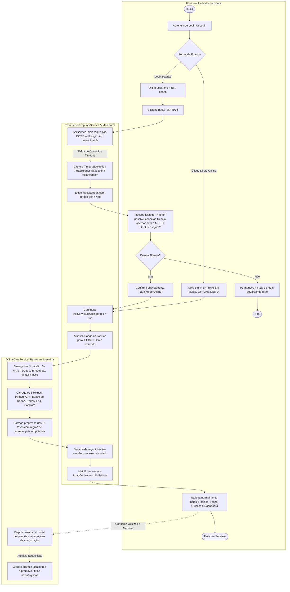
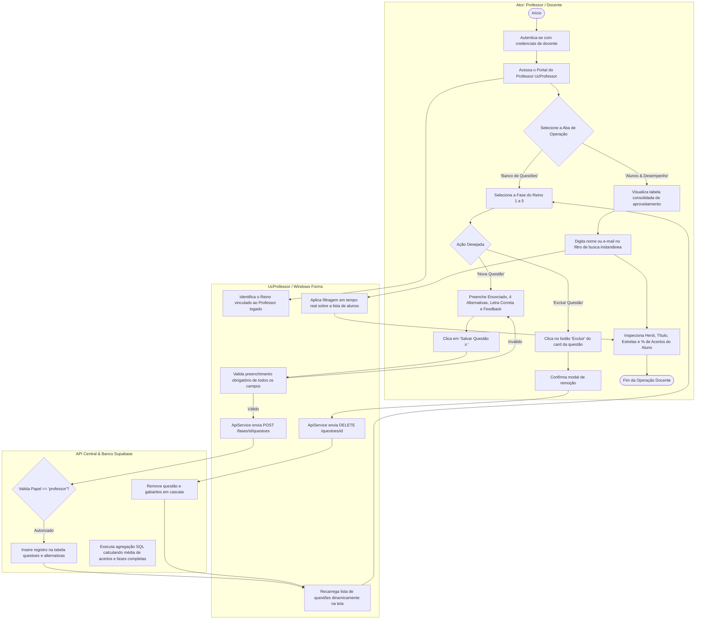
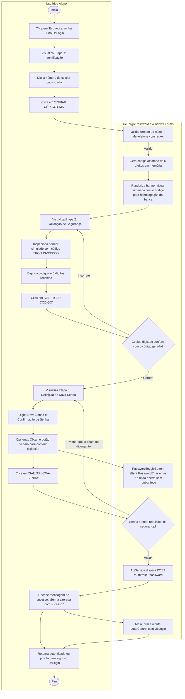
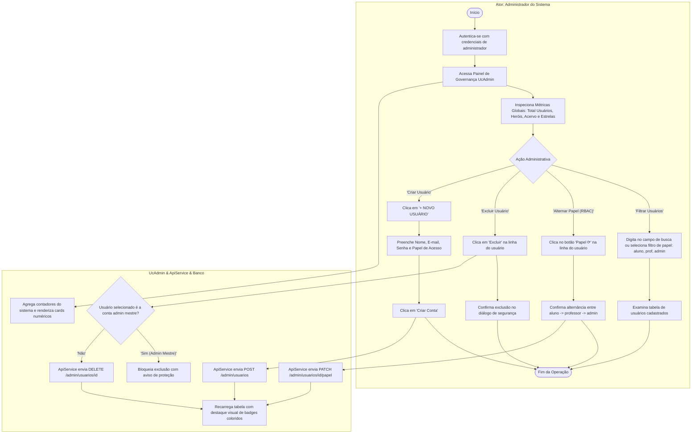
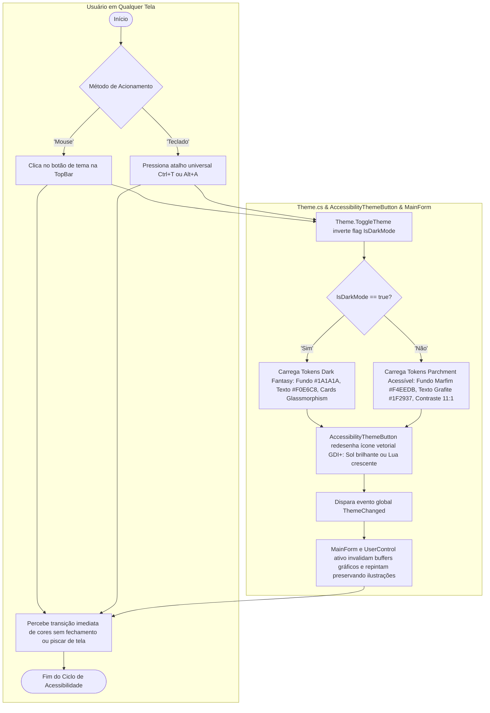

# 🔄 Diagrama de Atividades (UML) — Tronus Desktop

**Projeto Integrado Multidisciplinar (PIM III) — UNIP 2026**  
**Curso:** Superior de Tecnologia em Análise e Desenvolvimento de Sistemas (ADS)  
**Disciplina de Referência:** Engenharia de Software Ágil Aplicada  
**Plataforma de Aplicação:** Tronus Desktop (.NET 10 / C# Windows Forms)  
**Modelagem:** Padrão UML 2.5 / Compatível com Astah UML  

---

## 📌 Sumário

1. [Visão Geral e Metodologia](#1-visão-geral-e-metodologia)
2. [Notação e Elementos da UML Adotados](#2-notação-e-elementos-da-uml-adotados)
3. [DA01 — Jornada Gamificada do Aluno (Resolução de Desafios e Evolução Nobiliárquica)](#3-da01--jornada-gamificada-do-aluno-resolução-de-desafios-e-evolução-nobiliárquica)
4. [DA02 — Resiliência Operacional e Fallback para o Modo Offline](#4-da02--resiliência-operacional-e-fallback-para-o-modo-offline)
5. [DA03 — Gestão Pedagógica de Questões pelo Professor (CRUD e Avaliação)](#5-da03--gestão-pedagógica-de-questões-pelo-professor-crud-e-avaliação)
6. [DA04 — Recuperação Segura de Credenciais (Wizard SMS em 3 Etapas)](#6-da04--recuperação-segura-de-credenciais-wizard-sms-em-3-etapas)
7. [DA05 — Governança Global e Gestão de Usuários pelo Administrador (RBAC)](#7-da05--governança-global-e-gestão-de-usuários-pelo-administrador-rbac)
8. [DA06 — Ciclo Universal de Acessibilidade e Alternância de Temas (WCAG AAA)](#8-da06--ciclo-universal-de-acessibilidade-e-alternância-de-temas-wcag-aaa)
9. [Matriz de Rastreabilidade (Casos de Uso vs. Atividades vs. Telas)](#9-matriz-de-rastreabilidade-casos-de-uso-vs-atividades-vs-telas)
10. [Tutorial Passo a Passo para Modelagem no Software Astah UML](#10-tutorial-passo-a-passo-para-modelagem-no-software-astah-uml)

---

## 1. Visão Geral e Metodologia

O **Diagrama de Atividades** é o artefato comportamental da **UML (Unified Modeling Language)** responsável por descrever o **fluxo de controle operacional e de dados** passo a passo dentro do sistema. Enquanto o Diagrama de Casos de Uso define *o que* o sistema executa e o Diagrama de Sequência estabelece *a troca de mensagens no tempo*, o Diagrama de Atividades detalha a **lógica procedural dos processos de negócio**, exibindo:

- Nós de ação e estados de execução;
- Bifurcações e tomadas de decisão condicional (*Decision Nodes* e *Merge Nodes*);
- Paralelismo e sincronização de fluxos (*Forks* e *Joins*);
- Raias de responsabilidade (*Swimlanes / Partitions*), segregando as ações executadas pelo **Usuário**, pela interface do **Tronus Desktop** e pela **API REST / Banco de Dados / Motor Offline**.

No ecossistema do **Tronus Desktop**, a modelagem de atividades foi concebida para formalizar com máxima precisão os fluxos críticos de gamificação, as rotinas pedagógicas e os diferenciais de resiliência (Modo Offline) e acessibilidade (WCAG AAA).

---

## 2. Notação e Elementos da UML Adotados

Os diagramas utilizam a especificação formal da UML 2.5:

| Elemento Gráfico | Nome UML | Significado e Função no Tronus Desktop |
| :---: | :---: | :--- |
| 🟢 `([Início])` | **Nó Inicial (Initial Node)** | Ponto de partida do fluxo operacional. Representa a inicialização da tela ou o disparo do gatilho pelo usuário. |
| 🔲 `[Ação]` | **Nó de Ação (Action Node)** | Execução de um passo atômico de trabalho (ex: "Digitar credenciais", "Renderizar cards", "Calcular estrelas"). |
| 🔶 `{Decisão}` | **Nó de Decisão (Decision Node)** | Ponto de ramificação baseado em condições booleanas ou regras de negócio (Guard Conditions `[ ]`). |
| 🔷 `{Junção}` | **Nó de Mesclagem (Merge Node)** | Convergência de dois ou mais fluxos alternativos em um único fluxo subsequente. |
| ➖ `====` | **Barra de Fork / Join** | Divisão de um fluxo em atividades paralelas concorrentes (Fork) ou espera pela conclusão de todas (Join). |
| 🛑 `([Fim])` | **Nó Final de Atividade (Final Node)** | Término bem-sucedido ou encerramento do processo em execução. |
| 🏊 `Raias` | **Partições (Swimlanes)** | Colunas que delimitam os limites de responsabilidade de cada ator ou camada arquitetural do sistema. |

---

## 3. DA01 — Jornada Gamificada do Aluno (Resolução de Desafios e Evolução Nobiliárquica)

Este diagrama representa o fluxo nuclear da experiência do estudante no Tronus Desktop: desde o acesso aos reinos, execução interativa das 5 questões pedagógicas com feedback dinâmico, envio do gabarito, atribuição de estrelas e a evolução automática de patentes nobiliárquicas (Plebeu a Rei).

### 3.1 Diagrama de Atividades com Raias (Swimlanes)

```mermaid
flowchart TD
    subgraph Aluno [Ator: Aluno / Estudante]
        A_Start([Início da Sessão]) --> A_NavReinos[Explora o Mapa dos Reinos UcReinos]
        A_NavReinos --> A_SelectFase[Clica no botão 'Jogar' ou 'Refazer' de uma Fase liberada]
        A_SelectFase --> A_WaitQuiz[Visualiza Desafio em UcQuiz]
        
        A_WaitQuiz --> A_ReadQuestao[Lê o Enunciado e as 4 Alternativas A-D]
        A_ReadQuestao --> A_ClickAlt[Seleciona a Alternativa desejada]
        A_ClickAlt --> A_CheckNext{É a 5ª questão?}
        A_CheckNext -- Não --> A_ClickNext[Clica em 'Próxima ➔']
        A_ClickNext --> A_ReadQuestao
        A_CheckNext -- Sim --> A_ClickFinish[Clica em 'FINALIZAR ⚔']
        
        A_ResultScreen[Visualiza Cartão de Vitória: Estrelas ★, Pontuação e Título] --> A_DecideNext{Próximo Passo?}
        A_DecideNext -- 'Voltar ao Mapa' --> A_NavReinos
        A_DecideNext -- 'Ver Desempenho' --> A_ViewDashboard[Acessa Painel de Métricas UcDashboard]
        A_ViewDashboard --> A_End([Fim do Ciclo de Estudo])
    end

    subgraph Desktop [Tronus Desktop .NET 10 / C#]
        D_LoadQuiz[UcQuiz carrega ID da Fase e Nome do Reino]
        D_ReqQuestoes[ApiService dispara GET /fases/id/questoes]
        D_RenderQuestao[Renderiza Enunciado rolável, Badge de Dificuldade e Botões]
        D_PackageAnswers[Empacota EnviarRespostasRequest com lista de QuestaoId e AlternativaId]
        D_SendAnswers[ApiService dispara POST /fases/id/responder]
        D_RenderVictory[Centraliza ResultCard dinamicamente, atualiza HUD com novas estrelas]
        D_UnlockNext[Habilita botão 'Jogar' na Fase seguinte do Reino]
    end

    subgraph Backend [Backend API NestJS / Supabase / Motor Offline]
        B_FetchQ[Consulta acervo de questões pedagógicas sem gabarito exposto]
        B_ProcessResult[Motor de Correção confere respostas contra gabarito oficial]
        B_CountStars[Calcula estrelas da rodada: 5=3★ | 3-4=2★ | 1-2=1★ | 0=0★]
        B_SaveBest[Atualiza progresso preservando a melhor marca com GREATEST]
        B_SumStars[Calcula TotalEstrelas acumuladas pelo Herói]
        B_EvalTitle{Total de Estrelas?}
        B_TitleRei[Atribui Título: 👑 Rei >= 45★]
        B_TitleDuque[Atribui Título: 🦅 Duque >= 30★]
        B_TitleCavaleiro[Atribui Título: 🎖️ Cavaleiro >= 15★]
        B_TitlePlebeu[Mantém Título: 🛡️ Plebeu < 15★]
        B_ReturnDto[Retorna ResultadoQuizResponse com DTO do Herói atualizado]
    end

    A_SelectFase --> D_LoadQuiz
    D_LoadQuiz --> D_ReqQuestoes
    D_ReqQuestoes --> B_FetchQ
    B_FetchQ --> D_RenderQuestao
    D_RenderQuestao --> A_WaitQuiz
    
    A_ClickFinish --> D_PackageAnswers
    D_PackageAnswers --> D_SendAnswers
    D_SendAnswers --> B_ProcessResult
    B_ProcessResult --> B_CountStars
    B_CountStars --> B_SaveBest
    B_SaveBest --> B_SumStars
    B_SumStars --> B_EvalTitle
    
    B_EvalTitle -- '>= 45' --> B_TitleRei
    B_EvalTitle -- '>= 30' --> B_TitleDuque
    B_EvalTitle -- '>= 15' --> B_TitleCavaleiro
    B_EvalTitle -- '< 15' --> B_TitlePlebeu
    
    B_TitleRei & B_TitleDuque & B_TitleCavaleiro & B_TitlePlebeu --> B_ReturnDto
    B_ReturnDto --> D_RenderVictory
    D_RenderVictory --> D_UnlockNext
    D_UnlockNext --> A_ResultScreen
```

### 3.2 Tabela de Regras Operacionais do DA01
- **Regra de Desbloqueio de Fases:** A Fase 1 de cada reino nasce liberada. A Fase 2 só é desbloqueada se a Fase 1 possuir ao menos 1 estrela (`Estrelas > 0`). Idem para a Fase 3.
- **Regra da Melhor Marca (`GREATEST`):** Ao refazer uma fase, caso o aluno tire uma pontuação menor, suas estrelas originais são preservadas.
- **Regra Nobiliárquica:**
  - `0 a 14 estrelas`: Plebeu
  - `15 a 29 estrelas`: Cavaleiro
  - `30 a 44 estrelas`: Duque
  - `45+ estrelas`: Rei do Reino

---

## 4. DA02 — Resiliência Operacional e Fallback para o Modo Offline

Este diagrama modela a inteligência de tolerância a falhas do cliente desktop. Foi concebido para demonstrar à banca avaliadora da UNIP como a aplicação se comporta de forma ininterrupta mesmo diante de oscilações de rede, proxies bloqueados ou indisponibilidade temporária de nuvem.

### 4.1 Diagrama de Atividades de Conectividade e Chaveamento



### 4.2 Tabela de Estados de Conectividade
- `IsOfflineMode == false`: Requisições trafegam criptografadas via HTTPS na porta 443 para a Vercel/Supabase.
- `IsOfflineMode == true`: Todas as chamadas de API são interceptadas silenciosamente e respondidas pelo `OfflineDataService.cs` em memória RAM, com latência simulada de 30-40ms e sem geração de tráfego externo.
- **Comutação Dinâmica:** O usuário pode alternar a qualquer momento clicando no badge da TopBar (`🟢 Online` ⇋ `⚡ Offline (Demo)`).

---

## 5. DA03 — Gestão Pedagógica de Questões pelo Professor (CRUD e Avaliação)

Este diagrama modela as atividades desempenhadas pelo corpo docente da UNIP (Requisitos RF11 e RF12), responsáveis pela governança de conteúdo de sua respectiva disciplina/reino acadêmico.

### 5.1 Diagrama de Atividades do Portal Docente



---

## 6. DA04 — Recuperação Segura de Credenciais (Wizard SMS em 3 Etapas)

Modela o fluxo de segurança do Requisito Funcional RF10 para restauração de senhas esquecidas através de validação de dois fatores simulada por SMS.

### 6.1 Diagrama de Atividades do Fluxo de Recuperação



---

## 7. DA05 — Governança Global e Gestão de Usuários pelo Administrador (RBAC)

Modela as atividades de governança administrativa (Requisito RF13), permitindo auditoria, criação de contas mestre e promoção dinâmica de papéis de acesso (*Role-Based Access Control*).

### 7.1 Diagrama de Atividades da Governança



---

## 8. DA06 — Ciclo Universal de Acessibilidade e Alternância de Temas (WCAG AAA)

Modela o funcionamento em tempo real do sistema de acessibilidade visual do Tronus Desktop, presente de forma perene no cabeçalho da aplicação.

### 8.1 Diagrama de Atividades de Acessibilidade



---

## 9. Matriz de Rastreabilidade (Casos de Uso vs. Atividades vs. Telas)

A matriz abaixo estabelece a correlação bidirecional entre os Casos de Uso funcionais, os fluxos de atividade modelados e os componentes de interface (`UserControls`) do Tronus Desktop:

| Caso de Uso (UML) | Código do DA | Nome do Fluxo de Atividade | UserControl / Tela | Regra de Negócio Chave |
| :--- | :---: | :--- | :--- | :--- |
| **UC01: Cadastro de Aluno** | DA01 | Registro de novo estudante | `UcRegister.cs` | Validação de força de senha e unicidade de e-mail. |
| **UC02: Efetuar Login** | DA02 | Autenticação e Fallback | `UcLogin.cs` | Roteamento por papel e detecção de timeout para Modo Offline. |
| **UC03: Recuperar Senha** | DA04 | Restauração de Senha em 3 Etapas | `UcForgotPassword.cs` | Validação de celular, SMS com 6 dígitos e senha mínima de 8 chars. |
| **UC04: Forjar Herói** | DA01 | Criação do Personagem do Calouro | `UcCharacter.cs` | Escolha de gênero e batismo obrigatório do avatar. |
| **UC05: Explorar Reinos** | DA01 | Navegação no Mapa e Desbloqueio | `UcReinos.cs` | Liberação sequencial de fases condicionada a `Estrelas > 0`. |
| **UC06: Responder Quiz** | DA01 | Resolução de Desafio Gamificado | `UcQuiz.cs` | Enunciado rolável, 5 questões e gabarito protegido até submissão. |
| **UC07: Pontuar Respostas** | DA01 | Atribuição de Estrelas e Título | `UcQuiz.cs` | 5 acertos = 3★; 3-4 = 2★; 1-2 = 1★. Promoção a Cavaleiro, Duque e Rei. |
| **UC08: Desempenho / Dashboard** | DA01 | Consulta de Métricas e KPIs | `UcDashboard.cs` | Cálculo de precisão geral e histórico consolidado por fase. |
| **UC09: Hall dos Heróis** | DA01 | Visualização do Ranking Geral | `UcRanking.cs` | Pódio com Ouro, Prata e Bronze e destaque para o card do aluno. |
| **UC10: Gestão de Questões** | DA03 | Manutenção do Acervo Pedagógico | `UcProfessor.cs` | CRUD de questões e justificativas vinculado ao reino do docente. |
| **UC11: Consulta de Rendimento** | DA03 | Acompanhamento de Alunos | `UcProfessor.cs` | Busca instantânea e visualização de fases completas por aluno. |
| **UC12: Governança do Sistema** | DA05 | Gestão Administrativa e RBAC | `UcAdmin.cs` | Métricas de sistema, promoção de papéis e blindagem da conta mestre. |
| **UC13: Acessibilidade Universal** | DA06 | Alternância de Tema Claro/Escuro | `AccessibilityThemeButton.cs` | WCAG AAA, atalhos Ctrl+T / Alt+A e preservação das artes visuais. |

---

## 10. Tutorial Passo a Passo para Modelagem no Software Astah UML

Para os avaliadores acadêmicos e membros do grupo que desejarem inspecionar ou reproduzir os Diagramas de Atividade no software oficial **Astah UML**, segue o roteiro prático passo a passo:

### 10.1 Arquivos Oficiais do Projeto Astah Gerados
O projeto Astah completo contendo os 6 Diagramas de Atividades modelados (`DA01` a `DA06`), com suas raias de responsabilidade, nós de ação, decisões e fluxos operacionais, já foi gerado e disponibilizado oficialmente no repositório:
- **`DiagramasDeAtividade.asta`** (Formato padrão nativo do Astah UML)
- **`DiagramasDeAtividade.astah`** (Cópia no formato `.astah` para submissão acadêmica na UNIP)

Ao abrir o arquivo no Astah UML, os 6 diagramas estarão listados diretamente na árvore do projeto (*Structure Tree*), prontos para visualização, refinamento ou exportação em alta resolução.

### 10.2 Criação e Edição Manual de Novos Diagramas no Astah
1. Abra o arquivo de projeto no Astah (`DiagramasDeAtividade.asta`).
2. Na árvore de estrutura (*Structure Tree*) à esquerda, clique com o botão direito no pacote **Tronus Desktop** (ou na raiz do projeto).
3. Selecione a opção **`Create Diagram`** ➔ **`Activity Diagram`**.
4. Nomeie o diagrama (ex: `DA01 - Jornada Gamificada do Aluno`).

### 10.2 Inserção das Raias de Responsabilidade (Swimlanes / Partitions)
1. Na barra de ferramentas superior do Astah, selecione a ferramenta **`Swimlane`** (ícone de colunas divididas).
2. Clique na área de desenho para criar três raias verticais:
   - Raia 1: **Aluno (Estudante)**
   - Raia 2: **Tronus Desktop (.NET 10)**
   - Raia 3: **Backend API / Motor Offline**
3. Ajuste a largura das raias para acomodar os blocos com folga.

### 10.3 Inserção dos Nós de Ação, Decisões e Fluxos
1. **Nó Inicial:** Selecione a ferramenta **`Initial Node`** (círculo preto preenchido) e posicione no topo da raia *Aluno*.
2. **Ações:** Selecione **`Action`** (retângulo de cantos arredondados) para representar cada passo do fluxo (ex: *Lê Enunciado*, *Empacota Respostas*, *Calcula Estrelas*).
3. **Decisões:** Selecione **`Decision Node`** (losango) sempre que houver ramificações (ex: *É a 5ª questão?*, *Conexão com Sucesso?*).
4. **Fluxos de Controle:** Utilize a ferramenta **`Control Flow`** (seta contínua) para ligar os nós. Dê dois cliques sobre a seta de saída de um losango para inserir a condição de guarda entre colchetes (ex: `[Sim]`, `[Não]`).
5. **Nó Final:** Selecione **`Flow Final Node`** ou **`Activity Final Node`** (círculo com borda dupla) para demarcar o término do processo.

### 10.4 Exportação de Imagens e Salvamento
1. Acesse o menu **`Tool`** ➔ **`Export Image`** ➔ **`Save Diagram as PNG`**.
2. Salve o arquivo do projeto através do menu **`File`** ➔ **`Save`** (`.asta`).
3. Crie uma cópia com extensão **`.astah`** para garantir conformidade com a entrega acadêmica da UNIP.

---

<div align="center">
<b>TRONUS DESKTOP — DOCUMENTAÇÃO DE ENGENHARIA DE SOFTWARE</b><br>
Projeto Integrado Multidisciplinar (PIM III) · Universidade Paulista (UNIP) · 2026
</div>
