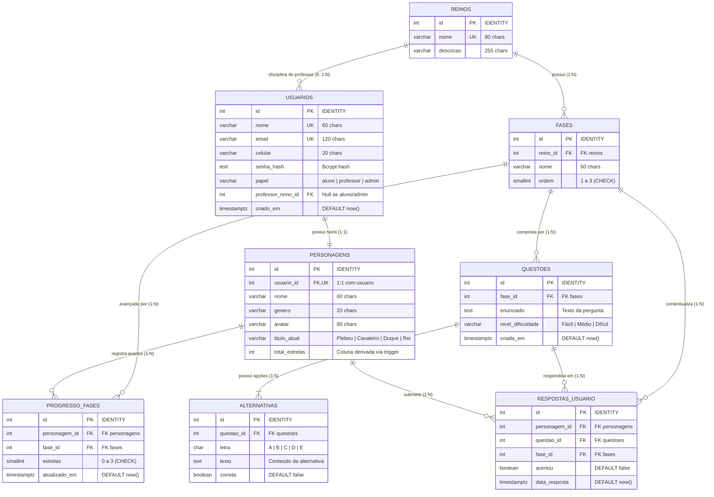
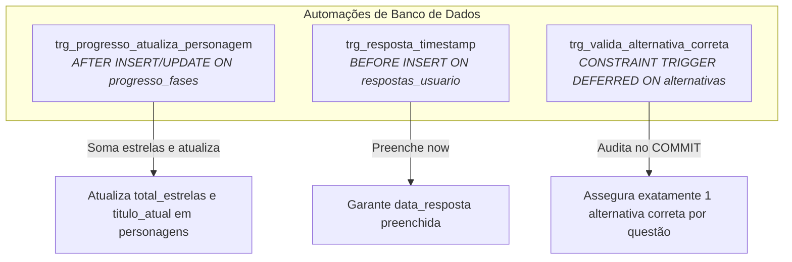

# 🐘 Documentação Técnica do Schema de Banco de Dados — Tronus

**Projeto Integrado Multidisciplinar (PIM III) — UNIP 2026**  
**Curso:** Superior de Tecnologia em Análise e Desenvolvimento de Sistemas (ADS)  
**Disciplina de Referência:** Banco de Dados / Engenharia de Software  
**SGBD Oficial:** PostgreSQL 15+ (Hospedado no Supabase BaaS)  
**Clientes Consumidores:** Web (HTML5/ES6), Desktop Nativo (.NET 10 C# WinForms) e API REST  

---

## 📌 Sumário Executivo

1. [Visão Geral e Arquitetura do Banco](#1-visão-geral-e-arquitetura-do-banco)
2. [Diagrama Entidade-Relacionamento (DER / Mermaid)](#2-diagrama-entidade-relacionamento-der--mermaid)
3. [Dicionário de Dados das Tabelas](#3-dicionário-de-dados-das-tabelas)
   - [3.1 reinos](#31-tabela-reinos)
   - [3.2 usuarios](#32-tabela-usuarios)
   - [3.3 personagens](#33-tabela-personagens)
   - [3.4 fases](#34-tabela-fases)
   - [3.5 progresso_fases](#35-tabela-progresso_fases)
   - [3.6 questoes](#36-tabela-questoes)
   - [3.7 alternativas](#37-tabela-alternativas)
   - [3.8 respostas_usuario](#38-tabela-respostas_usuario)
4. [Lógica de Negócio em Banco (PL/pgSQL)](#4-lógica-de-negócio-em-banco-plpgsql)
   - [4.1 Funções de Limiares e Gamificação](#41-funções-de-limiares-e-gamificação)
   - [4.2 Procedures de Persistência com GREATEST](#42-procedures-de-persistência-com-greatest)
   - [4.3 Funções Analíticas e Estatísticas](#43-funções-analíticas-e-estatísticas)
5. [Triggers de Consistência e Integridade](#5-triggers-de-consistência-e-integridade)
6. [Mapeamento Cruzado: Operações HTTP (`POST`) vs. SQL (`INSERT`)](#6-mapeamento-cruzado-operações-http-post-vs-sql-insert)
7. [Segurança (Row Level Security - RLS) e Otimização de Índices](#7-segurança-row-level-security---rls-e-otimização-de-índices)
8. [Ordem de Execução e Validação Automatizada](#8-ordem-de-execução-e-validação-automatizada)

---

## 1. Visão Geral e Arquitetura do Banco

O banco de dados relacional do **Tronus** foi projetado para atuar como o **núcleo de verdade unificado** para múltiplas aplicações clientes (Web, Desktop C# .NET 10 e futura versão mobile). 

Anteriormente estruturado em SQLite local (`js/database.js`), o sistema foi migrado e normalizado para **PostgreSQL**, hospedado na nuvem através do **Supabase**. Essa migração eliminou discrepâncias entre os clientes, descentralizou a lógica de regras de negócio para funções nativas (`PL/pgSQL`) e triggers atômicas, e assegurou conformidade estrita com a **3ª Forma Normal (3FN)**.

> [!NOTE]
> Toda lógica de pontuação de estrelas, recálculo de total de estrelas e promoção de patentes nobiliárquicas (`Plebeu` $\to$ `Cavaleiro` $\to$ `Duque` $\to$ `Rei`) é executada no próprio banco por meio de triggers, garantindo que nenhum cliente desktop ou web deixe dados inconsistentes.

---

## 2. Diagrama Entidade-Relacionamento (DER / Mermaid)

Abaixo está a modelagem conceitual e lógica completa das entidades, relacionamentos e cardinalidades:



---

## 3. Dicionário de Dados das Tabelas

### 3.1 Tabela: `reinos`
Representa as matérias/disciplinas do curso acadêmico estruturadas no mapa da gamificação.

| Coluna | Tipo | Nulo? | Restrições / Padrão | Descrição |
| :--- | :--- | :---: | :--- | :--- |
| `id` | `INTEGER` | **Não** | `PRIMARY KEY GENERATED ALWAYS AS IDENTITY` | Identificador único autoincremental. |
| `nome` | `VARCHAR(80)` | **Não** | `UNIQUE` | Nome da disciplina (ex: Python, C++, Redes). |
| `descricao` | `VARCHAR(255)` | Sim | — | Breve sinopse curricular do reino. |

* **Regras de Integridade:** Não permite nomes duplicados. É a raiz hierárquica para fases e para vinculação de professores.

---

### 3.2 Tabela: `usuarios`
Centraliza o controle de acesso de todos os atores (Estudantes, Professores e Administradores).

| Coluna | Tipo | Nulo? | Restrições / Padrão | Descrição |
| :--- | :--- | :---: | :--- | :--- |
| `id` | `INTEGER` | **Não** | `PRIMARY KEY GENERATED ALWAYS AS IDENTITY` | Identificador único do usuário. |
| `nome` | `VARCHAR(60)` | **Não** | `UNIQUE` | Nome completo ou de exibição. |
| `email` | `VARCHAR(120)` | **Não** | `UNIQUE` | E-mail acadêmico para login e recuperação. |
| `celular` | `VARCHAR(20)` | **Não** | — | Telefone para verificação 2FA / SMS. |
| `senha_hash` | `TEXT` | **Não** | — | Hash seguro da senha gerado com Bcrypt (custo 10). |
| `papel` | `VARCHAR(10)` | **Não** | `DEFAULT 'aluno'`, `CHECK IN ('aluno', 'professor', 'admin')` | Perfil de permissão do usuário. |
| `professor_reino_id` | `INTEGER` | Sim | `FOREIGN KEY (reino_id) ON DELETE RESTRICT` | Reino associado se o papel for docente. |
| `criado_em` | `TIMESTAMPTZ` | **Não** | `DEFAULT now()` | Timestamp de cadastro com fuso horário. |

* **Restrição de Negócio (`ck_usuarios_reino_do_professor`):**
  ```sql
  CHECK (
      (papel = 'professor' AND professor_reino_id IS NOT NULL)
      OR (papel <> 'professor' AND professor_reino_id IS NULL)
  )
  ```
  *Garante que todo professor esteja estritamente atrelado a um Reino, e nenhum calouro/admin possua reino diretamente.*

---

### 3.3 Tabela: `personagens`
Guarda a persona do calouro na jornada medieval, centralizando total de estrelas e títulos.

| Coluna | Tipo | Nulo? | Restrições / Padrão | Descrição |
| :--- | :--- | :---: | :--- | :--- |
| `id` | `INTEGER` | **Não** | `PRIMARY KEY GENERATED ALWAYS AS IDENTITY` | Identificador único do herói. |
| `usuario_id` | `INTEGER` | **Não** | `UNIQUE`, `FOREIGN KEY (usuarios.id) ON DELETE CASCADE` | Vínculo 1:1 estrito com a conta do aluno. |
| `nome` | `VARCHAR(60)` | **Não** | — | Nome do herói acadêmico batizado pelo aluno. |
| `genero` | `VARCHAR(20)` | **Não** | — | Gênero selecionado (`Masculino` ou `Feminino`). |
| `avatar` | `VARCHAR(80)` | **Não** | — | Identificador do sprite/imagem (`masc1`, `fem2`, etc). |
| `titulo_atual` | `VARCHAR(20)` | **Não** | `DEFAULT 'Plebeu'`, `CHECK IN ('Plebeu', 'Cavaleiro', 'Duque', 'Rei')` | Patente nobiliárquica atual. |
| `total_estrelas` | `INTEGER` | **Não** | `DEFAULT 0`, `CHECK (total_estrelas >= 0)` | **Coluna derivada.** Mantida 100% por trigger. |

> [!WARNING]
> **Atenção:** As colunas `total_estrelas` e `titulo_atual` **nunca** devem ser atualizadas manualmente pela API ou cliente. A trigger [`trg_progresso_atualiza_personagem`](#5-triggers-de-consistência-e-integridade) recalcula esses valores automaticamente em qualquer alteração de progresso.

---

### 3.4 Tabela: `fases`
Cada Reino é composto por exatamente três Fases de complexidade crescente.

| Coluna | Tipo | Nulo? | Restrições / Padrão | Descrição |
| :--- | :--- | :---: | :--- | :--- |
| `id` | `INTEGER` | **Não** | `PRIMARY KEY GENERATED ALWAYS AS IDENTITY` | Identificador único da fase. |
| `reino_id` | `INTEGER` | **Não** | `FOREIGN KEY (reinos.id) ON DELETE CASCADE` | Vínculo ao Reino pertencente. |
| `nome` | `VARCHAR(60)` | **Não** | — | Nome temático da fase. |
| `ordem` | `SMALLINT` | **Não** | `DEFAULT 1`, `CHECK (ordem BETWEEN 1 AND 3)` | Posição sequencial na trilha (1, 2 ou 3). |

* **Restrição de Unicidade:** `UNIQUE (reino_id, ordem)` — Impede a existência de duas fases com o mesmo número de ordem dentro da mesma matéria.

---

### 3.5 Tabela: `progresso_fases`
Armazena a melhor pontuação de estrelas obtida pelo estudante em cada fase concluída.

| Coluna | Tipo | Nulo? | Restrições / Padrão | Descrição |
| :--- | :--- | :---: | :--- | :--- |
| `id` | `INTEGER` | **Não** | `PRIMARY KEY GENERATED ALWAYS AS IDENTITY` | Identificador do registro. |
| `personagem_id` | `INTEGER` | **Não** | `FOREIGN KEY (personagens.id) ON DELETE CASCADE` | Personagem do aluno. |
| `fase_id` | `INTEGER` | **Não** | `FOREIGN KEY (fases.id) ON DELETE CASCADE` | Fase avaliada. |
| `estrelas` | `SMALLINT` | **Não** | `DEFAULT 0`, `CHECK (estrelas BETWEEN 0 AND 3)` | Quantidade de estrelas conquistadas (0 a 3). |
| `atualizado_em` | `TIMESTAMPTZ` | **Não** | `DEFAULT now()` | Data e hora da última conquista. |

* **Restrição de Unicidade:** `UNIQUE (personagem_id, fase_id)` — Cada herói tem exatamente uma linha de progresso por fase, atualizada via upsert.

---

### 3.6 Tabela: `questoes`
Banco de desafios avaliativos por fase, gerenciado pelos professores.

| Coluna | Tipo | Nulo? | Restrições / Padrão | Descrição |
| :--- | :--- | :---: | :--- | :--- |
| `id` | `INTEGER` | **Não** | `PRIMARY KEY GENERATED ALWAYS AS IDENTITY` | Identificador único da questão. |
| `fase_id` | `INTEGER` | **Não** | `FOREIGN KEY (fases.id) ON DELETE CASCADE` | Fase à qual a pergunta pertence. |
| `enunciado` | `TEXT` | **Não** | — | Texto completo com problema, código ou exemplo. |
| `nivel_dificuldade` | `VARCHAR(10)` | **Não** | `DEFAULT 'Médio'`, `CHECK IN ('Fácil', 'Médio', 'Difícil')` | Calibrador de dificuldade pedagógica. |
| `criada_em` | `TIMESTAMPTZ` | **Não** | `DEFAULT now()` | Data de criação no repositório docente. |

---

### 3.7 Tabela: `alternativas`
As 5 alternativas (A a E) correspondentes a cada questão.

| Coluna | Tipo | Nulo? | Restrições / Padrão | Descrição |
| :--- | :--- | :---: | :--- | :--- |
| `id` | `INTEGER` | **Não** | `PRIMARY KEY GENERATED ALWAYS AS IDENTITY` | Identificador da alternativa. |
| `questao_id` | `INTEGER` | **Não** | `FOREIGN KEY (questoes.id) ON DELETE CASCADE` | Vínculo com a questão. |
| `letra` | `CHAR(1)` | **Não** | `CHECK (letra IN ('A', 'B', 'C', 'D', 'E'))` | Letra identificadora da opção. |
| `texto` | `TEXT` | **Não** | — | Conteúdo explicativo da alternativa. |
| `correta` | `BOOLEAN` | **Não** | `DEFAULT FALSE` | `TRUE` se for a opção de gabarito correto. |

* **Restrição de Unicidade:** `UNIQUE (questao_id, letra)` — Impede letras duplicadas para a mesma questão.
* **Integridade Funcional:** Garantida por trigger diferida, exigindo exatamente 1 alternativa correta por questão ao commitar.

---

### 3.8 Tabela: `respostas_usuario`
Histórico detalhado de cada resposta submetida pelos alunos durante os quizzes.

| Coluna | Tipo | Nulo? | Restrições / Padrão | Descrição |
| :--- | :--- | :---: | :--- | :--- |
| `id` | `INTEGER` | **Não** | `PRIMARY KEY GENERATED ALWAYS AS IDENTITY` | Identificador da submissão. |
| `personagem_id` | `INTEGER` | **Não** | `FOREIGN KEY (personagens.id) ON DELETE CASCADE` | Aluno que respondeu. |
| `questao_id` | `INTEGER` | **Não** | `FOREIGN KEY (questoes.id) ON DELETE CASCADE` | Pergunta submetida. |
| `fase_id` | `INTEGER` | **Não** | `FOREIGN KEY (fases.id) ON DELETE CASCADE` | Fase do desafio. |
| `acertou` | `BOOLEAN` | **Não** | `DEFAULT FALSE` | Indicador se o calouro acertou o gabarito. |
| `data_resposta` | `TIMESTAMPTZ` | **Não** | `DEFAULT now()` | Timestamp do envio para relatórios de engajamento. |

---

## 4. Lógica de Negócio em Banco (PL/pgSQL)

### 4.1 Funções de Limiares e Gamificação

```sql
-- Converte o somatório de estrelas na respectiva patente nobiliárquica
CREATE OR REPLACE FUNCTION fn_titulo_por_estrelas(p_total INTEGER)
RETURNS VARCHAR(20) LANGUAGE plpgsql IMMUTABLE AS $$
BEGIN
    IF p_total IS NULL OR p_total < 15 THEN
        RETURN 'Plebeu';
    ELSIF p_total < 30 THEN
        RETURN 'Cavaleiro';
    ELSIF p_total < 45 THEN
        RETURN 'Duque';
    ELSE
        RETURN 'Rei';
    END IF;
END;
$$;
```

### 4.2 Procedures de Persistência com `GREATEST`

A gravação do progresso preserva o **melhor resultado histórico** do estudante. Um aluno que refaz a fase para treinar e tira nota menor não perde as estrelas que já conquistou:

```sql
CREATE OR REPLACE PROCEDURE sp_registrar_progresso(
    p_personagem_id INTEGER,
    p_fase_id       INTEGER,
    p_estrelas      SMALLINT
) LANGUAGE plpgsql AS $$
BEGIN
    IF p_estrelas IS NULL OR p_estrelas NOT BETWEEN 0 AND 3 THEN
        RAISE EXCEPTION 'Estrelas devem estar entre 0 e 3 (recebido: %).', p_estrelas;
    END IF;

    INSERT INTO progresso_fases (personagem_id, fase_id, estrelas)
    VALUES (p_personagem_id, p_fase_id, p_estrelas)
    ON CONFLICT (personagem_id, fase_id) DO UPDATE
        SET estrelas      = GREATEST(progresso_fases.estrelas, EXCLUDED.estrelas),
            atualizado_em = now();
END;
$$;
```

### 4.3 Funções Analíticas e Estatísticas

O banco provê queries compiladas de alta performance consumidas pelos dashboards:
* **`fn_estatisticas_personagem(p_personagem_id)`**: Retorna taxa de acertos e estrelas consolidadas por reino e fase.
* **`fn_resumo_geral(p_personagem_id)`**: Calcula total de respostas, acertos, taxa percentual global, estrelas totais, fases iniciadas e fases com gabarito perfeito (3 estrelas).
* **`fn_buscar_alunos(p_nome TEXT)`**: Permite aos professores pesquisar estudantes via busca semântica insensível a maiúsculas (`ILIKE`).

---

## 5. Triggers de Consistência e Integridade

O Tronus possui 3 triggers essenciais ativas:



1. **`trg_progresso_atualiza_personagem`** (`AFTER INSERT OR UPDATE OR DELETE ON progresso_fases`):
   Recalcula instantaneamente o `total_estrelas` do herói através de `SUM(estrelas)` e invoca `fn_titulo_por_estrelas()` para rebaixar ou promover o título (`Plebeu` a `Rei`).
2. **`trg_resposta_timestamp`** (`BEFORE INSERT ON respostas_usuario`):
   Garante que o campo `data_resposta` nunca receba `NULL` mesmo se a API enviar explicitamente um payload com campo nulo.
3. **`trg_valida_alternativa_correta`** (`CONSTRAINT TRIGGER DEFERRED ON alternativas`):
   Verifica no momento do `COMMIT` se a questão possui **exatamente 1 alternativa marcada como `correta = TRUE`**. Evita que um professor salve questões sem gabarito ou com respostas ambíguas.

---

## 6. Mapeamento Cruzado: Operações HTTP (`POST`) vs. SQL (`INSERT`)

A tabela abaixo estabelece o vínculo direto entre os endpoints chamados pelas aplicações clientes e os comandos SQL executados na camada de persistência:

| Ação de Negócio | Endpoint HTTP (`POST`) | Comando SQL Relacionado (`INSERT` / Upsert) | Triggers Disparadas |
| :--- | :--- | :--- | :--- |
| **Cadastro de Aluno** | `POST /auth/register` | `INSERT INTO usuarios (...)` | Nenhuma |
| **Criação de Herói** | `POST /personagens` | `INSERT INTO personagens (usuario_id, nome, genero, avatar, titulo_atual, total_estrelas)` | Vínculo 1:1 validado |
| **Envio de Gabarito de Questão** | `POST /fases/{id}/responder` | `INSERT INTO respostas_usuario (personagem_id, questao_id, fase_id, acertou)` | `trg_resposta_timestamp` |
| **Atualização do Progresso** | `POST /fases/{id}/responder` | `CALL sp_registrar_progresso(...)` $\to$ `INSERT INTO progresso_fases (...) ON CONFLICT DO UPDATE` | `trg_progresso_atualiza_personagem` |
| **Cadastro Docente de Questões** | `POST /fases/{id}/questoes` | `INSERT INTO questoes (...)` e `INSERT INTO alternativas (...)` em lote (A a E) | `trg_valida_alternativa_correta` (no Commit) |

---

## 7. Segurança (Row Level Security - RLS) e Otimização de Índices

### 7.1 Row Level Security (RLS)
O Supabase expõe automaticamente uma API PostgREST pública baseada nas tabelas do schema `public`. Para impedir que qualquer requisição anônima contornando a aplicação leia ou altere registros, o RLS foi habilitado em **todas** as tabelas:

```sql
ALTER TABLE reinos            ENABLE ROW LEVEL SECURITY;
ALTER TABLE usuarios          ENABLE ROW LEVEL SECURITY;
ALTER TABLE personagens       ENABLE ROW LEVEL SECURITY;
ALTER TABLE fases             ENABLE ROW LEVEL SECURITY;
ALTER TABLE progresso_fases   ENABLE ROW LEVEL SECURITY;
ALTER TABLE questoes          ENABLE ROW LEVEL SECURITY;
ALTER TABLE alternativas      ENABLE ROW LEVEL SECURITY;
ALTER TABLE respostas_usuario ENABLE ROW LEVEL SECURITY;
```
*Como nenhuma política permissiva pública foi criada, o acesso direto via PostgREST é totalmente bloqueado. Apenas o backend autenticado com papel de serviço (`service_role`) possui privilégios de escrita e leitura.*

### 7.2 Índices para Alta Performance
O PostgreSQL cria índices B-Tree automáticos para chaves primárias e constraints de unicidade (`UNIQUE`), mas não indexa automaticamente chaves estrangeiras (`FOREIGN KEY`). Para otimizar os joins mais frequentes, foram criados 7 índices estratégicos:

```sql
CREATE INDEX idx_fases_reino          ON fases (reino_id);
CREATE INDEX idx_progresso_personagem ON progresso_fases (personagem_id);
CREATE INDEX idx_questoes_fase        ON questoes (fase_id);
CREATE INDEX idx_alternativas_questao ON alternativas (questao_id);
CREATE INDEX idx_respostas_personagem ON respostas_usuario (personagem_id);
CREATE INDEX idx_respostas_questao    ON respostas_usuario (questao_id);
CREATE INDEX idx_usuarios_papel       ON usuarios (papel);
```

---

## 8. Ordem de Execução e Validação Automatizada

Para provisionar o ambiente a partir do zero ou rodar testes de regressão, a ordem estrita dos arquivos é:

1. **`01_schema.sql`**: Limpeza (`DROP CASCADE`), criação das 8 tabelas, constraints, chaves estrangeiras, índices e habilitação de RLS.
2. **`02_seeds.sql`**: Carga inicial dos 5 Reinos (Python, C++, Engenharia de Software, Banco de Dados e Redes), 15 Fases e 15 questões completas de Python com 75 alternativas.
3. **`02b_seed_usuarios.sql`**: Inserção de contas de homologação com hashes Bcrypt (`admin` e `prof_python`).
4. **`03_procedures.sql`**: Compilação de funções de limiares, procedimentos com `GREATEST` e queries de dashboard.
5. **`04_triggers.sql`**: Ativação das triggers de consistência de personagens, timestamps e validação diferida de gabaritos.
6. **`99_validacao.sql`**: Suíte de validação automatizada em 7 etapas que testa integridade referencial, bloqueio de múltiplas alternativas corretas, funcionamento do `GREATEST` e avanço de patentes nobiliárquicas.
